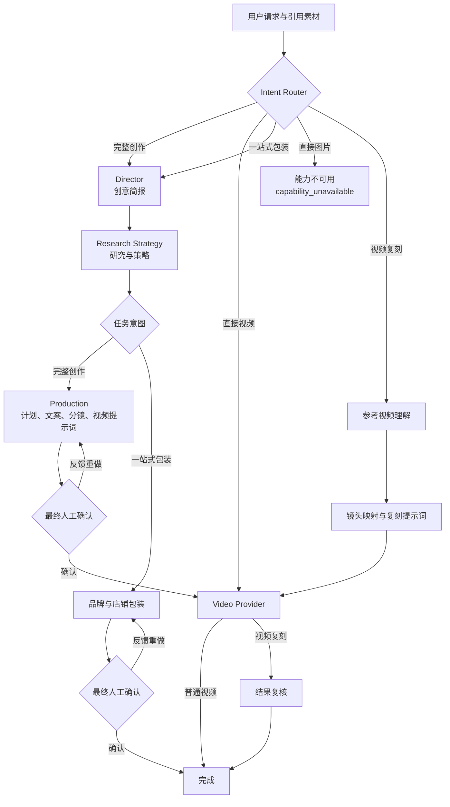

# JHAi-to-C

[](https://github.com/2p5gkkffb5-cpu/JHAi-to-C/actions/workflows/ci.yml)
[](./LICENSE)


面向 AI 内容生产的全栈 Agent 工作台。主应用从一句创作需求出发，通过 Director、Research Strategy 和 Production 生成创意简报、研究策略、文案、分镜与视频提示词，并在用户最终确认后进入视频生成。

> **English:** JHAi-to-C is a full-stack agentic content production workspace built with React, FastAPI and LangGraph. It supports auditable multi-step workflows, persisted checkpoints, human approval, cancellation and provider-backed video generation. The default Mock mode runs locally without paid API keys.

> 当前版本是开发预览，不应直接按生产环境部署。真实图片生成和部分 Studio 能力仍在建设中，详见 [PRODUCT_STATUS.md](./PRODUCT_STATUS.md)。

## 项目亮点

- **完整 Agent 链路**：Director → Research Strategy → Production → 最终人工确认 → Video Provider。
- **后端真实暂停**：最终确认由 LangGraph 检查点和工作流状态约束，不是仅在前端模拟等待。
- **可审计执行事件**：持久化面向用户的 Thought / Action / Observation 摘要、轮次、任务 ID 和结构化输出。
- **可恢复任务**：支持反馈重做、取消、失败状态和检查点恢复，已完成事件与产物不会被静默覆盖。
- **视频复刻工作流**：结合原生视频理解、FFmpeg 关键帧联系表、替换素材映射和成片复核。
- **离线可演示**：默认 Mock Provider，无付费 API Key 也能跑通核心流程。

## 代码边界

```text
JHAi-to-C/
├── apps/
│   ├── api/                         # FastAPI + LangGraph + SQLite
│   └── web/                         # React + JavaScript + Vite
├── data/                            # 本地样例素材
├── docs/                            # 产品与技术文档
├── scripts/start.sh                 # 本地前后端启动脚本
├── PRODUCT_STATUS.md                # 当前能力、优先级和已知边界
├── CONTRIBUTING.md                  # 开发、提交和验收规范
└── README.md
```

`apps/web` 与 `apps/api` 是唯一正式发布基线。前端通过 `/api` 代理连接后端，不再维护独立视觉原型或第二套前端。

公开仓库不分发私有开发时抓取的页面资源、用户上传内容或来源不明的参考素材。界面改用仓库自有的中性占位图，详见 [公开素材策略](./docs/PUBLIC_ASSET_POLICY.md)。设计参考图、浏览器截图、QA 对比图、测试输出和阶段性执行报告也不属于交付源码，已通过 `.gitignore` 排除。

## 技术栈

| 模块 | 技术 |
| --- | --- |
| Web | React 19、JavaScript、Vite 6 |
| API | Python 3.12、FastAPI、Pydantic 2、SQLAlchemy 2 |
| Agent | LangGraph 1.2 |
| 数据 | SQLite、Alembic、LangGraph Checkpoint |
| 工具链 | npm、uv |

## 快速开始

环境要求：Node.js `22.x`、npm、Python `3.12.x`、uv。

```bash
cp .env.example .env
npm ci --prefix apps/web
npm run dev
```

默认地址：

- Web：`http://127.0.0.1:5174`
- API 文档：`http://127.0.0.1:8000/docs`
- OpenAPI：`http://127.0.0.1:8000/openapi.json`

`.env.example` 默认启用 Mock Provider，可离线跑通完整演示。真实 LLM、搜索和视频 Provider 必须显式配置，配置不完整时不会静默回退到 Mock。

当前测试分支默认关闭登录，前后端分别通过 `AUTH_ENABLED=false` 和 `VITE_AUTH_ENABLED=false` 直接以访客身份运行。需要恢复账号体系时，将两项同时改为 `true` 后重启服务。

## 常用开发命令

一次运行全部本地检查：

```bash
npm run check
```

其中 `check:public` 会拒绝被 Git 跟踪的数据库、checkpoint、真实 `.env`、上传目录、日志、QA 截图和常见凭据格式。

前端：

```bash
cd apps/web
npm test
npm run build
```

后端：

```bash
cd apps/api
uv sync --frozen
uv run ruff check .
uv run pytest
```

前端默认使用 `5174` 端口，并把 `/api` 代理到 `http://127.0.0.1:8000`。

## 当前工作流

正式 API 当前以 `enable_intent_routing=True` 和 `require_final_approval=True` 构建 LangGraph 状态机。用户可以显式选择创作模式；`AUTO` 模式由 Intent Router 根据请求和引用素材判断实际意图。



流程图源与导出文件位于 [`diagrams/`](./diagrams/)：包含 Mermaid 源文件、SVG、PNG 和可在 Excalidraw 中继续编辑的版本。

### 路由行为

| 模式 | 实际执行链路 | 当前结果 |
| --- | --- | --- |
| 完整创作 | Director → Research Strategy → Production → 最终确认 → Video Provider | 默认主链路。Research 自动选择推荐策略；用户只在 Production 完整交付后确认或反馈重做。 |
| 直接视频 | Intent Router → Video Provider | 将用户请求直接组装为视频提示词并提交，不运行 Director、Research Strategy 和 Production。 |
| 直接图片 | Intent Router → Image Generation | 当前主动返回 `capability_unavailable`，不会伪装成已完成能力。 |
| 一站式包装 | Director → Research Strategy → Brand Packaging → 最终确认 | 仅在用户主动选择时进入；确认后交付品牌与店铺包装结果，不提交视频任务。 |
| 视频复刻 | Gemini 原生视频理解 + FFmpeg 技术参数/关键帧 → 镜头映射 → 复刻提示词 → Video Provider → 结果复核 | 小视频优先使用完整视频与时序关键帧联系表联合分析；视频超限、原生输入失败或超过独立超时后自动回退联系表，并记录实际分析依据。 |

视频复刻默认按 15 秒商业短视频设计：提示词覆盖钩子、主体建立、核心动作、细节强化和收束定格，
并把 1080p、音频、水印、尾帧和固定机位等生成参数作为结构化约束。参考视频仅用于提炼结构，
实际生成引用只包含镜头中使用的替换素材；字幕、价格和 CTA 默认预留安全区后期叠加。
视频复刻统一根据参考样片、替换素材和改编目标生成，不再按商品带货、口播种草或品牌短片分类。
当前视频复刻主要面向抖音，界面不提供平台选择，工作流内部固定使用抖音作为内容适配目标；
这不包含抖音账号授权或自动发布能力。
本地上传的替换图片由后端校验后转换成受限的 Base64 Data URL，直接作为 Seedance
`reference_image` 发送，因此开发环境不要求额外配置公网 OSS；外部图片仍使用原始 HTTPS URL。
FFmpeg 会把 4～6 张时序关键帧合成单张联系表再交给 Gemini，避免兼容网关在多图片部件下
长时间无响应；`VIDEO_UNDERSTANDING_NATIVE_TIMEOUT_SECONDS` 只约束原生视频尝试，关键帧
回退仍使用完整的 `LLM_TIMEOUT_SECONDS` 预算。
Seedance 参考素材生成模式不发送不受支持的 `camera_fixed` 结构化字段；固定或运动机位要求
仍由最终 Prompt 明确表达。纯文本生成模式则继续透传该参数。
替换图片会同时进入素材映射、最终 Prompt 和成片验收三个 Gemini 节点；主体描述和一致性判定
以真实图片像素为准，避免只根据文件名、颜色概括或 Prompt 文本产生误判。
Prompt 会显式区分替换素材主体与素材自带背景：默认只保持主体身份，不让素材底色延展为目标
场景；目标背景结构和运动光束必须用可验证的方向、颜色、轨迹和次数描述。

Production 当前是一个一体化 Agent，一次返回制作计划、营销文案、分镜和最终视频提示词。代码中虽保留 `production_coordinator → copywriting → storyboard → video_prompt` 的拆分子图，但它尚未接入正式 API 的默认主链路，不能视为当前线上执行方式。

### 确认、重做与取消

- 完整创作会自动执行 Director、Research Strategy 和 Production；Research 默认选中推荐策略，中间不要求用户逐步审批。
- Production 通过契约校验并完整持久化后，LangGraph 在后端审批节点真实暂停，项目进入 `waiting_approval`。前端不能绕过该检查点直接进入视频生成。
- 用户确认后，系统创建恢复任务并从检查点继续到 Video Provider；用户提交反馈重做时，只重新执行当前交付节点并保留之前的产物和事件。
- 一站式包装使用相同的最终确认机制，但确认后直接结束包装工作流。
- 用户取消会把项目和未完成任务标记为 `cancelled`，终止服务端当前执行及后续排队任务；已经产生的事件继续保留，供界面回看。
- 节点或 Provider 失败时，项目进入 `failed`，记录失败节点和公开错误摘要，并停止下游执行。

### 状态、产物与可审计事件

HTTP 接口只负责创建项目和排队任务，`WorkflowRunner` 负责实际执行。每个项目以 `project_id` 作为 LangGraph `thread_id`，SQLite Checkpointer 保存暂停和恢复位置；业务表另行保存项目状态、Agent 轮次、结构化产物、视频任务和事件记录。

每个节点执行时都会持久化以下信息：

1. 开始执行：更新项目当前节点，写入 `node.started`，并发送面向用户的 `trace.thought` 和 `trace.action` 进度摘要。
2. 完成执行：先校验结构化输出并保存 Artifact，再写入携带 `task_id`、轮次、Provider 和完整 `output` 的 `node.completed`，同时发送 `trace.observation`。
3. 等待确认：写入 `workflow.waiting_approval`，后端检查点保持暂停，直到收到确认或重做决定。
4. 视频生成：持续保存 Provider 任务状态和进度事件，最终成功、失败或取消状态都可恢复查询。

`trace.thought` 仅包含可公开的进度摘要，不暴露模型内部原始推理；界面展示的交付内容来自契约校验后的 `node.completed.output`，不能用摘要替代。

## 文档

- [产品状态与开发优先级](./PRODUCT_STATUS.md)
- [产品需求文档](./docs/PRODUCT_REQUIREMENTS_DOCUMENT.md)
- [系统架构](./docs/JHAi-to-C_Architecture.md)
- [MVP 技术方案](./docs/JHAi-to-C_MVP_Technical_Plan.md)
- [公开发布检查清单](./docs/PUBLIC_RELEASE_CHECKLIST.md)
- [公开素材策略](./docs/PUBLIC_ASSET_POLICY.md)
- [安全策略](./SECURITY.md)
- [贡献与提交规范](./CONTRIBUTING.md)

API 路径、Provider 配置和验证命令以本文档及各子项目 README 为准。历史阶段报告和本地执行记录不再作为当前事实来源。

## 许可证

项目代码采用 [MIT License](./LICENSE)。品牌名称与标识不因代码许可证自动授予商标使用权；第三方素材仍遵循其各自的授权条款。
