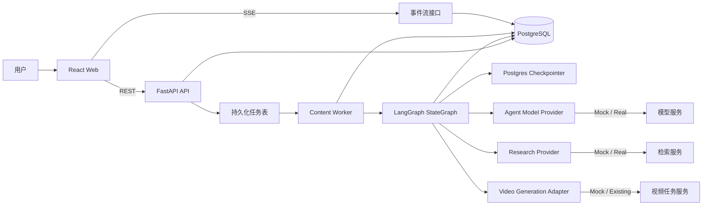
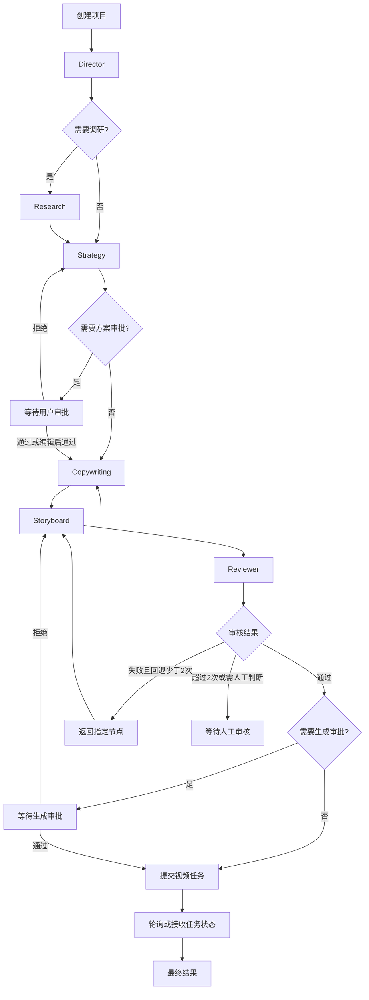

# AI 内容生产 Agent Demo 技术方案

> 状态：待确认  
> 日期：2026-07-16  
> 输入文档：`JHAi-to-C_Product_Task.md`、`JHAi-to-C_Implementation_Spec.md`

## 1. 结论

本 Demo 建议采用“项目优先（Project-first）”架构：所有需求、品牌事实、调研、策略、文案、分镜、审核、生成任务、版本和结果都归属于一个 `ContentProject`。

核心技术路线：

- 后端：Python 3.12、FastAPI、Pydantic v2、LangGraph `StateGraph`
- 数据：PostgreSQL、SQLAlchemy 2、Alembic、LangGraph PostgreSQL Checkpointer
- 异步：独立 Worker + PostgreSQL 持久化任务表，不在 FastAPI 请求进程中执行长任务
- 前端：React 19、TypeScript、Vite 8
- 实时状态：SSE + 可恢复事件流
- 外部能力：统一 Provider 适配层；第一阶段使用明确标记的 Mock Provider
- 测试：Pytest、Vitest、Testing Library、Playwright

第一版只做可演示的纵向闭环，不复制竞品工具集合，不实现无限自主 Supervisor，不引入 CrewAI、AutoGen、Dify Runtime、Flowise Runtime 或第二套编排框架。

## 2. 当前仓库审计结论

当前仓库仅包含：

```text
JHAi-to-C/
├── docs/
│   ├── JHAi-to-C_Product_Task.md
│   ├── JHAi-to-C_Implementation_Spec.md
│   └── JHAi-to-C_Architecture.md
└── README.md
```

未发现后端、前端、依赖清单、数据库迁移、鉴权、任务队列、图片/视频生成、积分、资产库或 Open Canvas 代码。因此：

1. 当前方案按“绿地 Demo”设计。
2. 两份产品文档中要求“复用现有能力”的部分暂时无法审计或确认。
3. 若后续需要接入另一个现有仓库，编码前必须重新完成真实仓库审计，并优先复用其鉴权、任务、资产、积分和生成 Service。
4. 在没有真实 Provider 的情况下，视频结果只能标记为 `provider=mock`，不得宣称已接入 Seedance 或其他真实服务。

## 3. 产品边界

### 3.1 Demo 必做

- 一句话创建 `ContentProject`
- 绑定品牌、商品、门店、活动和参考素材
- Director 生成结构化 Creative Brief
- Research 输出带来源类型和置信度的调研摘要
- Strategy 生成三套明显不同的营销方案
- 用户选择、编辑、审批方案
- Copywriting 生成结构化标题、Hook、口播、字幕和 CTA
- Storyboard 生成可编辑的镜头时间轴
- Reviewer 校验事实、时长、连续性、CTA 和 Provider 参数
- Reviewer 最多自动回退两次，之后转人工处理
- 通过审核后创建视频生成任务
- 展示项目、节点、任务和镜头状态
- 支持单镜头重做、候选选择和镜头锁定
- 上游编辑后自动将相关下游结果标记为 `stale`
- 保存最终结果，并可保存为企业蓝图
- Mock 与真实数据在界面和数据层明确区分

### 3.2 Demo 不做

- 全平台数据抓取、自动分发、投放和爆款预测
- 自研大模型、模型微调、数字人或完整换装系统
- 任意多 Agent 自主规划和无限循环
- 完整多人实时协同
- 复制 DAAI 的工具导航或“内容特工队”的角色视觉
- 第二套图片/视频任务、积分或资产系统
- 将普通确定性函数包装成 Agent

## 4. 总体架构



### 4.1 分层职责

- API 层：鉴权、参数校验、项目 CRUD、审批、编辑、重跑、SSE；不执行长工作流。
- 应用服务层：项目、Artifact、审批、镜头、蓝图、幂等和失效规则。
- 工作流层：LangGraph 节点、路由、审核回路和人工中断。
- Agent 层：理解、判断、生成结构化内容。
- Tool/Provider 层：事实查询、检索、素材、图片、视频、任务状态和资产保存。
- Worker 层：领取持久化任务、执行/恢复图、续租、超时和失败补偿。
- 持久化层：业务状态、版本、事件、任务和 LangGraph checkpoint。

### 4.2 为什么选择 LangGraph

本项目需要显式状态、条件路由、节点重跑、最多两轮审核、人工审批、暂停恢复和持久化 checkpoint，符合 LangGraph `StateGraph` 的使用场景。采用自定义图和白名单节点，不使用 Supervisor 封装。

LangGraph checkpoint 负责“工作流从哪里恢复”，业务表负责“用户看见什么、版本如何审计”。两者用途不同：

- Checkpoint：执行恢复、interrupt、故障恢复。
- Artifact/Event：产品数据、版本历史、审批、审计和前端查询。

## 5. 工作流设计

### 5.1 首个闭环



### 5.2 支持的工作流类型

首个融资 Demo 完整实现 `topic_to_video`，同时在 Director Schema 和 Registry 中预留：

- `brief_to_video`：信息完整时可跳过 Research。
- `script_to_video`：已有脚本时跳过 Strategy，直接解析和分镜。
- `reference_remix`：接入参考视频分析后做结构化重构。
- `product_image_set`：后续图片套图扩展，不进入首个闭环。

Director 只能从 Registry 选择已注册工作流和节点，不能动态创造 Agent。

### 5.3 Agent 与 Tool 边界

| 类型 | 组件 | 职责 |
| --- | --- | --- |
| Agent | Director | 解析需求、选择工作流、生成 Brief、记录假设和缺失字段 |
| Agent | Research | 整理可追溯调研，区分事实、外部来源和推断 |
| Agent | Strategy | 生成三套有真实差异的方案并评分 |
| Agent | Copywriting | 基于已确认方案生成结构化文案 |
| Agent | Storyboard | 生成结构化、可执行的镜头时间轴 |
| Agent | Reviewer | 输出问题和返回节点，不直接修改业务结果 |
| Tool | BrandFactLookup | 读取已确认品牌、商品、门店和活动事实 |
| Tool | ResearchProvider | Mock 或真实检索，保留来源元数据 |
| Tool | ReferenceAsset | 读取用户绑定的参考素材 |
| Tool | VideoGeneration | 提交/查询视频任务，不参与策略判断 |
| Tool | AssetSave | 保存生成结果并建立项目关联 |

### 5.4 确定性规则

以下由代码决定，模型无权覆盖：

- Agent 和工作流白名单
- Schema、节点顺序、最大重试和最大审核回路
- 审批模式与视频提交条件
- 事实字段绑定与禁用词
- 时长、时间线重叠、CTA 和必填字段校验
- 项目权限、任务幂等、取消、恢复和状态持久化
- Artifact 版本增长和下游 `stale` 传播

## 6. 核心数据模型

### 6.1 聚合关系

```text
ContentProject
├── Request / Context
├── Brand Entities
├── References
├── Artifacts + Versions
├── Agent Runs
├── Approvals
├── Shots + Shot Versions
├── Generation Tasks
├── Workflow Events
├── Final Result
└── Blueprint
```

### 6.2 表设计

| 表 | 用途 | 关键约束 |
| --- | --- | --- |
| `content_projects` | 项目主状态和当前节点 | `organization_id` 隔离；乐观锁 `version` |
| `content_project_artifacts` | Brief、Research、Strategy、Copy、Storyboard、Review | `(project_id, artifact_type, version)` 唯一 |
| `content_agent_runs` | 每次模型调用、Prompt/模型版本、原始输出、成本和错误 | raw 与 parsed 同时保留 |
| `content_workflow_events` | SSE 和审计事件 | `(project_id, sequence)` 唯一且递增 |
| `content_approvals` | 审批前后内容和意见 | 关联准确 Artifact 版本 |
| `content_shots` | 当前镜头状态和锁定标记 | `(project_id, shot_key)` 唯一 |
| `content_shot_versions` | 镜头编辑、候选和生成历史 | `(shot_id, version)` 唯一 |
| `content_generation_tasks` | 项目/镜头生成任务、Provider、成本和结果 | 幂等键唯一 |
| `content_blueprints` | 系统蓝图和企业蓝图 | 组织可见性约束 |
| `brand_entities` | 品牌、商品、门店、人物、活动和视觉事实 | 组织隔离、状态和有效期 |
| `content_feedback_events` | 用户选择、编辑、重做、锁定等行为 | 仅记录，不在 Demo 中训练模型 |
| `workflow_jobs` | Worker 的持久化任务、租约、重试和取消 | 幂等键、租约到期可恢复 |

LangGraph 自身 checkpoint 使用官方 PostgreSQL Checkpointer 的独立表，不与业务 Artifact 表混用。

### 6.3 事实锁定

- 价格、地址、活动、功效、门店和品牌禁用词必须来自 `brand_entities`。
- 文案和镜头中的关键字段保存 `fact_bindings`，不能仅保存自由文本。
- Campaign 过期或停用后不可新引用。
- 事实改变时，依赖它的 Artifact 和 Generation Task 标记为 `stale`。
- Agent 可提出假设，但必须放入 `assumptions`，不得伪装成事实。

### 6.4 版本与失效

每次 Agent 生成或用户编辑都新增版本，不原地覆盖历史内容。

```text
Strategy v2
→ Copywriting v1 stale
→ Storyboard v1 stale
→ Review v1 stale
→ Final Result stale
```

单镜头编辑只使该镜头的生成候选和最终合成失效；其他已锁定镜头保持有效。

## 7. 异步、恢复与幂等

### 7.1 执行模型

FastAPI 只写入 `workflow_jobs` 并返回 `202 Accepted`。独立 Worker 使用数据库租约领取任务，执行 LangGraph `ainvoke/astream`，并周期性续租。

不使用 FastAPI `BackgroundTasks` 承担工作流或视频生成，因为这些任务耗时长、需要跨进程恢复和独立扩缩容。

### 7.2 恢复策略

- 每个项目使用稳定的 LangGraph `thread_id=project_id`。
- 每个节点完成后写 checkpoint、Artifact 和 Event。
- Worker 异常退出后，租约超时的任务可被其他 Worker 重新领取。
- 人工审批使用 LangGraph `interrupt()`；恢复时使用同一 `thread_id`。
- interrupt 之前发生的外部副作用必须幂等，因为恢复会从节点开头重新执行。
- Provider 请求保存外部 `task_id`，恢复时先查询，不重复提交。

### 7.3 幂等策略

- `/start`、`/rerun`、单镜头生成和视频提交必须带 `Idempotency-Key`。
- 数据库唯一约束是最终防线，不能只依赖应用内缓存。
- 同一键返回首次请求结果，不重复调用 Provider、不重复扣费。
- Provider 提交成功但本地响应中断时，通过请求键或已保存外部任务 ID 对账。

## 8. API 设计

```text
POST   /api/content-projects
GET    /api/content-projects
GET    /api/content-projects/{project_id}
POST   /api/content-projects/{project_id}/start
POST   /api/content-projects/{project_id}/cancel
POST   /api/content-projects/{project_id}/resume
GET    /api/content-projects/{project_id}/events
PATCH  /api/content-projects/{project_id}/artifacts/{artifact_type}
POST   /api/content-projects/{project_id}/approvals
POST   /api/content-projects/{project_id}/rerun
POST   /api/content-projects/{project_id}/shots/{shot_id}/generate
POST   /api/content-projects/{project_id}/shots/{shot_id}/lock
POST   /api/content-projects/{project_id}/shots/{shot_id}/select-candidate
POST   /api/content-projects/{project_id}/save-as-blueprint
GET    /api/blueprints
GET    /api/brand-entities
```

编辑接口必须携带 `expected_version`。版本冲突返回 `409 Conflict`，前端重新拉取并提示用户，不静默覆盖。

SSE 事件至少包括：

```text
project.created
project.started
node.started
node.completed
node.failed
artifact.created
artifact.stale
approval.required
approval.completed
generation.submitted
generation.progress
generation.completed
generation.failed
project.completed
```

客户端携带 `Last-Event-ID` 恢复事件；SSE 断开时通过项目详情接口对账。

## 9. 前端方案

### 9.1 页面

- 首页：一句话输入、素材入口、四个场景卡、启动选项。
- 项目列表：状态、场景、当前阶段、更新时间和结果摘要。
- 项目工作区：融资演示的核心页面。
- 案例蓝图：三个内置可执行蓝图和企业模板。
- 品牌中心：品牌、商品、门店和活动的基础事实管理。
- 结果页：方案、文案、分镜、视频/Mock 结果和发布包。

### 9.2 工作区布局

```text
左侧：项目阶段、Agent 状态、耗时、重试和错误
中间：Brief / Research / Strategy / Copy / Storyboard / Review / Result
右侧：品牌事实、素材、审批、事件和生成队列
```

### 9.3 状态原则

- 后端是唯一事实来源。
- 前端不根据 UI 操作猜测节点已完成。
- 查询数据使用服务端缓存库，编辑表单使用本地状态。
- SSE 只用于增量通知，刷新后以 GET 项目详情恢复。
- `stale`、Mock、失败、等待审批必须显式展示。
- Provider 没有真实进度时只显示阶段状态，不伪造百分比。

## 10. Provider 设计

### 10.1 统一接口

- `AgentModelProvider.generate_structured()`：JSON Schema、超时、一次结构修复、Token、耗时、原始输出和标准化错误。
- `ResearchProvider.search()`：查询、来源、发布时间、提取摘要和失败降级。
- `VideoGenerationProvider.submit/status/cancel()`：现有任务适配、幂等、费用和结果资产。
- `AssetProvider.get/save()`：读取参考素材、保存生成结果。

### 10.2 Demo Provider

- `MockAgentModelProvider`：按节点返回稳定、完整的结构化结果，可模拟一次解析失败。
- `MockResearchProvider`：使用 `demo://` 来源并标记“Demo 数据”，不伪造媒体 URL。
- `MockVideoProvider`：`queued → processing → completed`，结果明确显示“Demo Provider”。

Provider 通过配置切换，但配置不能让前端自行决定是否为真实结果；后端响应必须携带 provider、model 和 mock 标记。

## 11. 推荐目录结构

```text
JHAi-to-C/
├── apps/
│   ├── api/
│   │   ├── app/
│   │   │   ├── api/
│   │   │   ├── agents/content_project/
│   │   │   ├── workflows/content_project/
│   │   │   ├── domain/content_project/
│   │   │   ├── services/
│   │   │   ├── providers/
│   │   │   ├── persistence/
│   │   │   ├── prompts/content_project/
│   │   │   ├── workers/
│   │   │   └── main.py
│   │   ├── migrations/
│   │   ├── tests/
│   │   └── pyproject.toml
│   └── web/
│       ├── src/
│       │   ├── app/
│       │   ├── pages/
│       │   ├── features/content-project/
│       │   ├── features/brand-center/
│       │   ├── features/blueprints/
│       │   ├── components/
│       │   ├── api/
│       │   ├── styles/
│       │   └── main.tsx
│       ├── tests/
│       └── package.json
├── packages/
│   └── contracts/
│       └── openapi-generated/
├── docs/
│   ├── content-project-demo/
│   │   ├── REPO_AUDIT.md
│   │   ├── ARCHITECTURE_DECISION.md
│   │   ├── IMPLEMENTATION_PLAN.md
│   │   └── DATA_FLOW.md
│   └── ...
├── infra/
│   └── docker-compose.yml
├── scripts/
├── .env.example
├── Makefile
└── README.md
```

说明：该目录只是确认后的目标结构；当前阶段不创建这些代码文件。

## 12. 开发计划

以下按单人全栈开发估算，真实 Provider 接入不计入确定工期。

### Phase 0：确认与审计（0.5—1 工程日）

- 确认本仓库是绿地项目还是需要迁入现有系统。
- 固定 Python、Node、LangGraph、FastAPI 和 Pydantic 兼容版本。
- 输出 `REPO_AUDIT.md`、`ARCHITECTURE_DECISION.md`、`IMPLEMENTATION_PLAN.md`、`DATA_FLOW.md`。
- 明确真实视频/图片/资产/积分能力是否存在。

验收：依赖、复用点、边界和风险已确认，才进入编码。

### Phase 1：数据与 Mock 后端（3—4 工程日）

- 建立数据库迁移、领域模型和 Pydantic Schema。
- 实现 Project、Artifact、Approval、Shot、Blueprint、Event 服务。
- 实现 LangGraph StateGraph、Registry、五个 Agent 节点和审核回路。
- 实现 PostgreSQL Checkpointer、持久化 Worker、幂等和 SSE。
- 实现三个 Mock Provider 和完整 Mock API 流程。
- 完成核心单元和集成测试。

验收：纯 API 可跑通 `topic_to_video`，可暂停审批、恢复、回退和重启恢复。

### Phase 2：融资演示前端（3—4 工程日）

- 首页、项目列表、三栏项目工作区和结果页。
- Agent 状态、Research 来源、三套方案、文案编辑、分镜和 Reviewer 问题面板。
- 审批、SSE、断线恢复、错误和 Mock 标识。
- 完成核心组件测试与主链路 E2E。

验收：用户从一句需求可完整走到明确标记的 Mock 视频结果。

### Phase 3：真实能力适配（取决于现有接口）

- 审计并适配现有鉴权、素材、图片、视频、任务、积分和资产 Service。
- 保持 Provider 接口不变，不重写底座。
- 增加提交失败补偿、对账和回归测试。

验收：真实任务与 Mock 任务可清楚区分，失败不重复扣费或提交。

### Phase 4：镜头级与蓝图（2—3 工程日）

- 单镜头编辑、重做、候选选择、锁定和历史版本。
- 最终重新合成状态。
- 三个 Seed 蓝图和“保存为企业蓝图”。

验收：重做第三镜头不影响其他已锁定镜头，上游修改正确传播 `stale`。

### Phase 5：演示收尾（1—2 工程日）

- Seed 品牌、商品、门店、活动和预置演示需求。
- 全量测试、构建、演示脚本和已知限制。
- 独立 Reviewer 复审，输出 `PASS` 或带证据的 `CONTINUE`。

## 13. 测试与验收

### 13.1 后端重点

- Director 工作流路由和未知节点拒绝。
- Agent 输出 Schema、一次结构修复和失败落库。
- Research 来源类型和 Mock 标记。
- 三套 Strategy 的差异性校验。
- 分镜总时长、时间重叠、CTA、事实绑定和素材存在性。
- Reviewer 严重级别、返回节点和最多两轮回退。
- Artifact 版本增长和 `stale` 传播。
- 审批暂停、恢复和进程重启恢复。
- Idempotency-Key 不重复建任务或产生费用。
- 单镜头重做不覆盖锁定镜头。
- 组织权限和跨组织访问拒绝。

### 13.2 前端重点

- 创建项目、阶段状态和三套方案选择。
- Artifact 编辑冲突处理。
- 审批、失败、重试和 `stale` 展示。
- SSE 更新和断线恢复。
- 分镜编辑、单镜头重做、候选选择和锁定。
- Mock Provider 明确标识。

### 13.3 首个演示验收链路

```text
输入鲸堡汉堡需求
→ Director Brief
→ Research（来源/推断标签）
→ 三套 Strategy
→ 选择并编辑 CTA
→ Copywriting
→ Storyboard
→ Reviewer Warning
→ 人工确认
→ Mock Video Task
→ 重做第三镜头
→ 锁定候选
→ 最终结果
→ 保存为企业蓝图
```

## 14. 安全与合规

- 所有项目、事实、素材和蓝图查询都校验 `organization_id` 和用户权限。
- API Key 只存在后端环境变量，不写入 Prompt、前端或日志。
- 企业知识作为不可信数据输入，不能覆盖系统指令。
- Tool 调用白名单；Agent 不直接访问数据库。
- 外部 URL 做协议、域名和内网地址校验，防止 SSRF。
- 上传沿用安全文件流程；若为绿地项目，首版仅允许受限类型和大小。
- Prompt、原始输出和日志避免保存无关敏感信息。
- 价格、地址、活动和功效宣传必须通过事实绑定和 Reviewer 校验。

## 15. 主要风险与应对

| 风险 | 影响 | 应对 |
| --- | --- | --- |
| 当前没有现有业务代码 | 无法确认“复用现有能力” | 确认绿地开发或提供目标仓库；接入前重新审计 |
| 没有真实视频 Provider | 无法展示真实成片 | Mock 明示；Provider 适配与主流程解耦 |
| LangGraph 与依赖版本冲突 | 无法安装或 checkpoint 异常 | Phase 0 做最小兼容性验证并锁定版本 |
| Checkpoint 与业务状态不一致 | 恢复后 UI 状态错误 | 节点提交采用短事务和 Outbox/Event；定期对账 |
| 模型输出不稳定 | Schema 失败或内容质量波动 | 结构化输出、一次修复、确定性校验、固定 Demo Seed |
| 审批恢复重复副作用 | 重复提交视频或扣费 | interrupt 前后严格划分；所有外部调用幂等 |
| 镜头级生成不被 Provider 支持 | 局部重做能力受限 | 每个 Shot 提交短视频或 Mock；如实标注限制 |
| SSE 断线或丢事件 | 前端状态不一致 | 递增事件序号、Last-Event-ID、详情接口对账 |
| 上游修改引发复杂失效 | 使用过期内容生成 | 显式依赖图、统一 stale service 和测试矩阵 |
| Demo 范围膨胀 | 延期且主链路不完整 | 先完成单场景纵向闭环，其他工作流只预留接口 |

## 16. 待确认决策

进入编码前需要确认以下五点：

1. `JHAi-to-C` 是否作为全新的绿地项目开发。
2. 首版是否接受 Mock-first，真实视频 Provider 在主闭环完成后接入。
3. 是否接受 PostgreSQL 持久化 Worker，首版不额外引入 Redis/Celery。
4. 首个完整工作流是否只做 `topic_to_video`，其他模式保留扩展接口。
5. 是否同意首版融资演示范围以“项目工作区、品牌事实、审批版本、镜头级重做”为核心，不扩展自动分发和完整工具广场。

确认后再进入 Phase 0 的依赖兼容性验证和四份审计/架构文档，不提前编写业务代码。

## 17. 参考依据

- LangGraph Persistence：<https://docs.langchain.com/oss/python/langgraph/persistence>
- LangGraph Interrupts：<https://docs.langchain.com/oss/python/langgraph/interrupts>
- FastAPI Background Tasks Caveat：<https://fastapi.tiangolo.com/tutorial/background-tasks/#caveat>
- React Versions：<https://react.dev/versions>
- Vite Guide：<https://vite.dev/guide/>

