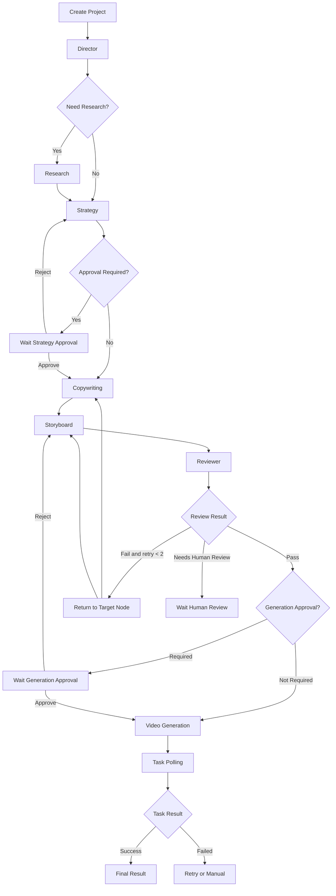

# Codex XHigh 任务书：融合 DAAI 与「内容特工队」的企业级 AI 内容项目 Demo

> **使用方式**：将本文件完整交给 Codex，并使用高强度推理模式执行。  
> **目标**：不是复制 DAAI，也不是复制「内容特工队」，而是在现有项目中实现一个可运行的差异化 Demo。  
> **核心定位**：**企业可控型 AI 内容生产平台**。  
> **产品原则**：DAAI 是工具优先，「内容特工队」是角色优先；本项目必须采用 **项目优先（Project-first）**。

---

## 0. Codex 的角色

你是本项目的：

- 高级产品架构师
- AI Agent 系统架构师
- FastAPI 后端工程师
- React 前端工程师
- 工作流与异步任务工程师
- 数据建模工程师
- 测试与质量工程师

你需要先审计当前代码，再设计和实现。不得在不了解仓库结构时直接大改。

你的任务不是“生成一堆看起来像 Agent 的页面”，而是完成一个真实可运行的垂直闭环：

```text
用户一句需求
→ 创建内容项目
→ 绑定品牌/商品/门店/人物/参考素材
→ Agent 生成 Brief
→ 调研
→ 3 套内容方案
→ 用户选择或编辑方案
→ 文案
→ 结构化分镜
→ 审核
→ 调用现有图片/视频生成能力
→ 支持单镜头重做
→ 保存最终成片与企业模板
```

---

# 1. 背景与竞品结论

本任务基于用户提供的 DAAI 全量界面截图和「内容特工队」界面截图。

## 1.1 DAAI 已经具备的公开产品能力

从截图可见，DAAI 已覆盖：

### 统一入口

- 首页统一自然语言输入
- 上传素材
- `@` 引用主体或参考素材
- Agent 模式
- 一键生成投流视频
- 一张图生成商品详情套图
- 快捷技能入口

### Agent

- 独立 Agent 页面
- 历史对话
- 新对话
- 素材上传
- 对话式创作

### AI 视频

- 最多约 15 个参考素材
- 视频脚本输入
- `@` 指定参考素材
- “帮我写”
- 模型选择
- 画幅、清晰度、时长设置
- 生成积分预估
- 异步任务队列
- 预览
- 收藏

### AI 图片

- 最多约 9 个参考素材
- 图片描述输入
- `/` 选择技能包
- `@` 引用参考图
- 模型选择
- 尺寸与格式设置
- 异步任务队列
- 预览
- 收藏

### 画布

- 文本、图片、视频、音频等节点
- 分析
- 改写
- 替换元素
- 图生图
- 图生视频
- 批量生成
- 可视化连线
- 教程和示例

### 发现与案例

- 发现、视频、图片、画布分类
- 精选案例瀑布流
- 原视频与复刻视频对照
- 图片案例
- 画布案例
- 点赞与收藏
- 快速复用

### 电商技能工具

- 商品详情套图
- 水印擦除
- 字幕擦除
- 画质增强
- 视频复刻
- 数字分身（规划或待上线）
- 模特换衣（规划或待上线）

### 资产与商业化

- 图片、视频等统一资产
- 生成任务队列
- 积分
- VIP 模型
- 订阅

**结论**：不能把“Agent、AI 图片、AI 视频、画布、一键复刻、案例广场、任务队列”当成我们的差异化。这些能力 DAAI 已经做得较完整。

---

## 1.2 「内容特工队」已经具备的公开产品能力

从截图可见，其产品表达是一个企业营销 Agent 团队：

- 市场研究 Agent
- 内容策划 Agent
- 内容制作 Agent
- 内容分发 Agent

同时包含：

- 统一任务输入
- 视频生成
- 真人口播视频
- 联网搜索
- 企业知识库
- 推广门店
- 插入剪辑素材
- 一句话生成
- 批量任务
- 资源
- 作品
- 知识库
- 矩阵
- 创作历史
- 精选案例或场景模板

**结论**：不能只做“多个 Agent 角色卡片”。这只是产品包装，不是壁垒。

---

## 1.3 本项目应采用的融合逻辑

不要做：

```text
DAAI 工具导航
+
内容特工队四个角色
=
功能拼盘
```

要做：

```text
内容项目
├── 品牌事实
├── 商品/门店/人物
├── 参考素材
├── 调研
├── 方案
├── 文案
├── 分镜
├── 镜头
├── 生成任务
├── 审批
├── 版本
├── 成片
└── 企业模板
```

Agent、图片工具、视频工具、画布和案例都必须归属于 **Content Project**。

---

# 2. 产品定位

## 2.1 定位

> **企业可控型 AI 内容生产平台**

## 2.2 一句话价值

> 从一句需求到完整营销内容项目，全流程可查看、可修改、可审批、可局部重做，并沉淀为企业自己的品牌与案例资产。

## 2.3 与竞品的差异

### DAAI：工具优先

用户在 AI 视频、AI 图片、画布和技能工具之间操作。

### 内容特工队：角色优先

用户感知多个专业 Agent 协作。

### 本项目：项目优先

用户进入一个项目，所有 Agent、工具、数据和版本都在项目中协同。

---

# 3. Demo 目标

本次是 **可演示的纵向 Demo**，不是完整生产系统。

必须完成以下主链路：

```text
创建项目
→ 选择场景
→ 绑定品牌/商品/门店/人物/参考素材
→ Director 生成 Creative Brief
→ Research 生成调研摘要
→ Strategy 生成 3 套方案
→ 用户选择并可编辑方案
→ Production 生成文案与分镜
→ Reviewer 审核
→ 通过后创建视频任务
→ 查看任务状态
→ 支持单镜头重新生成
→ 保存项目结果
```

Demo 必须体现三个核心差异：

1. **项目级工作区**
2. **结构化品牌事实锁定**
3. **镜头级可控生产与局部重做**

---

# 4. Demo 非目标

本次不要为了“看起来功能多”而实现以下内容：

- 不训练自有大模型
- 不微调多个 Agent 模型
- 不实现抖音全平台数据抓取
- 不承诺爆款预测
- 不实现任意竞品账号分析
- 不实现全平台自动发布
- 不实现复杂广告投放平台接入
- 不实现完整数字人系统
- 不实现完整模特换装系统
- 不实现真正的多人实时协同编辑
- 不重写现有图片/视频生成底座
- 不完整复制 DAAI 的导航和页面
- 不完整复制「内容特工队」的角色形象和视觉素材
- 不引入多套 Agent 框架
- 不把每个普通函数都包装成 Agent
- 不做无限自主循环的 Supervisor

---

# 5. 开始编码前的强制审计

## 5.1 仓库安全

开始前执行并记录：

```bash
git status
git branch --show-current
git log -5 --oneline
```

读取：

- 根目录 `AGENTS.md`
- README
- 项目开发规范
- 依赖管理文件
- 数据库迁移规范
- 当前图片生成流程
- 当前视频生成流程
- 当前任务队列/Worker
- 当前积分扣除与退款
- 当前资产库
- 当前 Open Canvas
- 当前鉴权与用户模型
- 当前测试结构

禁止：

```bash
git reset
git restore
git clean
```

禁止覆盖用户已有未提交修改。

## 5.2 先输出审计文档

在编码前生成：

```text
docs/content-project-demo/
├── REPO_AUDIT.md
├── ARCHITECTURE_DECISION.md
├── IMPLEMENTATION_PLAN.md
└── DATA_FLOW.md
```

文档中必须说明：

- 已有能力可复用点
- 现有视频任务创建入口
- 现有图片任务创建入口
- 现有异步状态机制
- 现有数据库与迁移机制
- 现有前端路由与状态管理
- 是否适合引入 LangGraph
- 依赖冲突风险
- 本次 Demo 改动范围
- 明确不改动的旧模块

---

# 6. 技术总原则

## 6.1 唯一编排内核

优先使用：

```text
LangGraph 自定义 StateGraph
```

但安装前必须检查现有 Python、FastAPI、Pydantic 和依赖兼容性。

如果直接引入 LangGraph 会引发严重依赖冲突，则实现一个等价的轻量状态机，并将接口设计成可迁移到 LangGraph。

禁止同时引入：

- CrewAI
- AutoGen
- Microsoft Agent Framework
- LangGraph Supervisor 封装
- Dify 运行时
- Flowise 运行时

本项目只能有一套编排内核。

## 6.2 确定性主流程 + 局部模型判断

模型可以决定：

- 工作流类型
- 是否需要调研
- 推荐哪个方案
- 审核失败后应该返回哪个内容节点

代码必须决定：

- Agent 白名单
- 节点顺序
- 输入输出 Schema
- 最大重试次数
- 最大审核回路次数
- 视频任务何时可以提交
- 任务幂等
- 状态持久化
- 用户权限
- 人工审批条件
- 取消和恢复

## 6.3 Agent 与 Tool 分离

### Agent

负责理解、判断和生成结构化内容：

- DirectorAgent
- ResearchAgent
- StrategyAgent
- ProductionAgent
- ReviewerAgent

### Tool

负责确定性操作：

- BrandFactLookupTool
- KnowledgeSearchTool
- WebResearchTool
- ReferenceAssetTool
- ReferenceVideoAnalysisTool
- ImageGenerationTool
- VideoGenerationTool
- TaskStatusTool
- AssetSaveTool

视频、图片生成不是 Agent，必须是 Tool/Service。

---

# 7. 信息架构

建议新增一级模块：

```text
AI 内容项目
```

不要直接照搬 DAAI 的导航。

## 7.1 推荐一级导航

```text
首页
内容项目
案例蓝图
批量生产
品牌中心
素材资产
专业工具
工作流
作品
```

Demo 至少完成：

- 首页入口
- 内容项目列表
- 内容项目工作区
- 案例蓝图
- 品牌中心基础页
- 作品/任务结果复用现有页面

---

# 8. 首页设计

## 8.1 统一输入框

首页提供一个大输入框：

```text
描述你是谁、要推广什么、面向谁、希望生成什么内容
```

支持：

- 普通文字
- 上传图片
- 上传视频
- `@品牌`
- `@商品`
- `@门店`
- `@人物`
- `@活动`
- `@参考素材`
- `@案例蓝图`

## 8.2 创作场景

至少提供四个场景卡片：

1. 本地门店到店获客
2. 商品投流视频
3. 真人口播脚本与视频
4. 参考视频结构重构

可选：

5. 商品详情套图
6. 品牌广告片

## 8.3 启动选项

- 联网调研：开/关
- 自动执行：开/关
- 审批模式：
  - 全自动
  - 方案后审批
  - 视频提交前审批
  - 每阶段审批
- 输出类型：
  - 视频项目
  - 图片套图
  - 文案与分镜
- 目标平台
- 目标时长
- 画幅

---

# 9. Content Project：核心领域模型

任何一次创作都必须先创建 `ContentProject`。

## 9.1 项目包含内容

```text
ContentProject
├── Request
├── Brand Context
├── Product Context
├── Store Context
├── Persona Context
├── Campaign Context
├── References
├── Creative Brief
├── Research
├── Strategies
├── Selected Strategy
├── Copywriting
├── Storyboard
├── Shots
├── Review
├── Generation Tasks
├── Final Result
├── Versions
├── Approvals
└── Events
```

## 9.2 项目状态

```text
draft
planning
researching
waiting_strategy_approval
writing
storyboarding
reviewing
waiting_generation_approval
generating
partially_completed
completed
failed
cancelled
```

## 9.3 节点状态

```text
pending
running
waiting_for_approval
completed
failed
skipped
cancelled
stale
```

`stale` 表示上游内容发生变化，下游旧结果已失效。

---

# 10. 支持的工作流模式

## 10.1 `topic_to_video`

用户只有一句模糊需求：

```text
Director
→ Research
→ Strategy
→ Approval
→ Production.Copywriting
→ Production.Storyboard
→ Reviewer
→ Approval
→ VideoGeneration
```

## 10.2 `brief_to_video`

用户已提供完整品牌、产品、目标和受众：

```text
Director
→ Strategy
→ Approval
→ Production.Copywriting
→ Production.Storyboard
→ Reviewer
→ VideoGeneration
```

Research 可选。

## 10.3 `script_to_video`

用户已有完整脚本：

```text
Director
→ Script Parse
→ Storyboard
→ Reviewer
→ VideoGeneration
```

不要强行重复做市场策略。

## 10.4 `reference_remix`

用户提供参考视频：

```text
Director
→ ReferenceVideoAnalysis
→ Controlled Reconstruction
→ Strategy
→ Storyboard
→ Reviewer
→ VideoGeneration
```

必须复用现有参考视频分析能力。

## 10.5 `product_image_set`

可选 Demo 扩展：

```text
Director
→ Product Fact Lookup
→ Image Strategy
→ Image Prompt
→ ImageGeneration
→ Review
```

---

# 11. 前台展示的 Agent

前台建议展示五个业务角色，但 Demo 可先实现四个主要角色。

## 11.1 市场研究 Agent

展示名称：

```text
市场研究
```

职责：

- 解析调研目标
- 使用联网搜索或 Mock Provider
- 结合品牌知识
- 输出用户、竞品、内容结构和风险
- 保存来源
- 区分事实、推断和建议

## 11.2 内容策划 Agent

展示名称：

```text
内容策划
```

职责：

- 基于 Brief 和调研生成 3 套差异化方案
- 为每套方案评分
- 推荐主方案
- 输出钩子、核心卖点、内容结构和 CTA

## 11.3 内容制作 Agent

展示名称：

```text
内容制作
```

内部包含确定的子节点：

```text
文案
→ 分镜
→ 视频提示词
→ 素材需求
```

前端可以折叠显示。

## 11.4 质量审核 Agent

展示名称：

```text
质量审核
```

职责：

- 品牌事实校验
- 文案与分镜一致性
- 时长与结构校验
- 视频参数校验
- 风险用语检查
- 确定返回哪个节点修改

## 11.5 内容分发 Agent

Demo 仅生成发布包，不做真实发布：

- 标题
- 平台正文
- 标签
- 封面建议
- 发布时间建议
- 评论区引导语

可作为 P1。

---

# 12. 内部 Agent 详细规范

## 12.1 DirectorAgent

### 输入

- 用户原始需求
- 已选场景
- 已绑定品牌/商品/门店/人物
- 参考素材
- 目标平台
- 时长
- 审批模式

### 输出

```json
{
  "workflow_type": "topic_to_video",
  "goal": "到店获客",
  "platform": "douyin",
  "industry": "餐饮",
  "content_type": "short_video",
  "duration_seconds": 20,
  "aspect_ratio": "9:16",
  "required_nodes": [
    "research",
    "strategy",
    "copywriting",
    "storyboard",
    "review",
    "video_generation"
  ],
  "missing_fields": [],
  "assumptions": [],
  "creative_brief": {
    "brand_id": "brand_x",
    "product_ids": ["product_x"],
    "store_ids": ["store_x"],
    "target_audience": "18-35 岁本地消费者",
    "core_goal": "提高到店转化",
    "tone": "直接、食欲感、快节奏",
    "must_include": [],
    "must_avoid": []
  }
}
```

### 约束

- 只能选择注册过的工作流
- 不得创建未知 Agent
- 不得直接调用视频 API
- 不得修改品牌事实
- 对缺失信息可做明确假设，但必须记录
- 关键事实缺失时进入用户确认，不得编造

---

## 12.2 ResearchAgent

### 输入

- Creative Brief
- 品牌事实
- 商品事实
- 门店事实
- 联网调研开关
- 用户提供的资料

### 输出

```json
{
  "research_questions": [],
  "audience_insights": [
    {
      "claim": "",
      "evidence_type": "source|brand_fact|user_input|inference",
      "source_ids": [],
      "confidence": 0.8
    }
  ],
  "competitor_patterns": [],
  "content_patterns": [],
  "platform_patterns": [],
  "risk_notes": [],
  "sources": [
    {
      "source_id": "src_001",
      "title": "",
      "publisher": "",
      "url": "",
      "published_at": null,
      "retrieved_at": "",
      "summary": "",
      "supported_claims": []
    }
  ],
  "generated_at": ""
}
```

### 约束

- 无来源时不能声称“实时调研发现”
- 模型常识必须标记为 `inference`
- 不得伪造链接
- 测试中使用 Mock Provider
- 联网服务失败时允许降级，但 UI 必须明确显示“基于品牌资料与模型推断”

---

## 12.3 StrategyAgent

### 输出 3 套方案

```json
{
  "strategy_options": [
    {
      "strategy_id": "s1",
      "name": "食欲刺激型",
      "summary": "",
      "target_audience": "",
      "core_message": "",
      "selling_points": [],
      "hook": "",
      "narrative_structure": [],
      "visual_direction": "",
      "cta": "",
      "risks": [],
      "scores": {
        "brand_fit": 0,
        "conversion_fit": 0,
        "execution_feasibility": 0,
        "differentiation": 0
      }
    }
  ],
  "recommended_strategy_id": "s1",
  "recommendation_reason": ""
}
```

### 约束

三套方案必须在以下至少一个维度上明显不同：

- 钩子
- 人物视角
- 核心卖点
- 叙事结构
- 内容风格
- CTA

不得只改标题。

---

## 12.4 ProductionAgent.Copywriting

### 输出

```json
{
  "title": "",
  "hook": "",
  "voiceover": "",
  "onscreen_text": [
    {
      "time_range": "0-3s",
      "text": ""
    }
  ],
  "cta": "",
  "estimated_duration_seconds": 20,
  "tone": "",
  "fact_bindings": [
    {
      "field": "price",
      "source_entity_id": "campaign_x"
    }
  ],
  "compliance_notes": []
}
```

### 约束

- 价格、地址、活动必须来自事实系统
- 不得自行扩展产品功效
- 不得篡改已选方案
- 时长必须可执行
- 字幕不应过密

---

## 12.5 ProductionAgent.Storyboard

### 输出

```json
{
  "total_duration_seconds": 20,
  "visual_identity": {
    "style": "",
    "palette": "",
    "lighting": "",
    "camera_language": ""
  },
  "continuity_rules": [],
  "audio_plan": {},
  "asset_requirements": [],
  "shots": [
    {
      "shot_id": "shot_001",
      "order": 1,
      "start_time": 0,
      "end_time": 3,
      "duration": 3,
      "purpose": "hook",
      "visual": "",
      "subject": "",
      "action": "",
      "camera": {
        "shot_size": "",
        "angle": "",
        "movement": ""
      },
      "lighting": "",
      "environment": "",
      "voiceover": "",
      "onscreen_text": "",
      "transition": "",
      "reference_asset_ids": [],
      "locked_fact_ids": [],
      "generation_prompt": ""
    }
  ]
}
```

### 硬校验

- `sum(shots.duration)` 与目标时长误差不得超过可配置阈值
- shot order 不重复
- 时间线不可重叠
- 每个镜头必须有 purpose
- 产品必须在规定时间内出现
- CTA 镜头存在
- 关键品牌事实有绑定

---

## 12.6 ReviewerAgent

### 输出

```json
{
  "status": "pass|fail|needs_human_review",
  "score": 86,
  "issues": [
    {
      "issue_id": "i1",
      "severity": "error|warning|info",
      "category": "brand_fact|duration|continuity|compliance|provider_param|copy_storyboard_mismatch",
      "message": "",
      "node": "storyboard",
      "field_path": "shots[2].onscreen_text",
      "suggested_fix": ""
    }
  ],
  "return_to": "storyboard",
  "required_changes": [],
  "severity_summary": {
    "error": 0,
    "warning": 1,
    "info": 2
  }
}
```

### 回路规则

- `error > 0`：不得提交视频
- 最多自动回退 2 次
- 超过 2 次进入 `needs_human_review`
- Reviewer 不得直接修改业务结果
- Reviewer 只给出结构化问题和返回节点
- 用户人工确认可覆盖 warning，不可默认覆盖 error

---

# 13. 品牌事实系统

这是本 Demo 的核心差异化之一。

## 13.1 实体类型

```text
brand
product
store
persona
campaign
offer
visual_identity
voice_identity
```

## 13.2 示例

### Brand

```json
{
  "id": "brand_001",
  "name": "鲸堡汉堡",
  "positioning": "年轻、现做、高性价比",
  "tone": ["直接", "轻松", "食欲感"],
  "forbidden_phrases": ["全网第一", "绝对最好"],
  "default_cta": "到店领取限时套餐",
  "logo_asset_id": "asset_logo_1"
}
```

### Product

```json
{
  "id": "product_001",
  "brand_id": "brand_001",
  "name": "双层牛肉芝士堡",
  "selling_points": ["双层牛肉", "现煎", "双层芝士"],
  "price": null,
  "image_asset_ids": [],
  "forbidden_claims": ["零脂肪", "减肥必吃"]
}
```

### Store

```json
{
  "id": "store_001",
  "brand_id": "brand_001",
  "name": "湖滨店",
  "city": "杭州",
  "district": "上城区",
  "address": "示例地址",
  "business_hours": "10:00-22:00",
  "image_asset_ids": []
}
```

### Campaign

```json
{
  "id": "campaign_001",
  "brand_id": "brand_001",
  "name": "暑期双人套餐",
  "start_at": "",
  "end_at": "",
  "price": 39.9,
  "terms": "",
  "active": true
}
```

## 13.3 事实锁定规则

- Agent 输出中涉及价格、地址、活动有效期时必须绑定事实 ID
- 下游节点只能读取确认后的事实
- 事实被修改后，相关下游 Artifact 自动标记为 `stale`
- 过期 Campaign 不得继续引用
- 禁用词必须在 Reviewer 中检查
- 用户人工输入的临时事实必须标记来源和有效期
- 事实字段不允许被自由文本结果覆盖

---

# 14. 案例蓝图

不要实现普通案例瀑布流的简单复制。

案例必须是可执行的 `ContentBlueprint`。

## 14.1 Blueprint 结构

```json
{
  "blueprint_id": "bp_local_store_food_001",
  "name": "本地餐饮制作过程获客",
  "industry": ["餐饮"],
  "goals": ["到店获客"],
  "platforms": ["douyin", "kuaishou", "video_account"],
  "duration_range": [15, 25],
  "required_slots": [
    "brand",
    "product",
    "store",
    "offer"
  ],
  "optional_slots": [
    "persona",
    "reference_video"
  ],
  "hook_pattern": "前三秒成品特写或制作瞬间",
  "narrative_structure": [
    "食欲钩子",
    "制作过程",
    "核心卖点",
    "价格/活动",
    "门店 CTA"
  ],
  "locked_rules": [
    "产品必须在 3 秒内出现",
    "CTA 必须绑定门店或活动"
  ],
  "default_shot_blueprint": [],
  "recommended_models": [],
  "default_provider_parameters": {}
}
```

## 14.2 Demo 内置三个 Blueprint

1. 本地餐饮到店获客
2. 电商产品卖点口播
3. 参考视频结构重构

## 14.3 用户操作

- 查看蓝图详情
- 查看需要补齐的变量
- 绑定品牌/商品/门店
- 一键创建项目
- 项目完成后“保存为企业模板”
- 企业模板只对当前组织可见

---

# 15. 可控重构

DAAI 已有一键复刻，因此本项目必须做得更可控。

## 15.1 参考视频分析结果

```json
{
  "hook_type": "",
  "duration": 20,
  "shot_count": 7,
  "shot_timeline": [],
  "narrative_structure": [],
  "subtitle_density": "",
  "camera_pattern": [],
  "transition_pattern": [],
  "emotion_curve": [],
  "product_exposure_pattern": [],
  "reusable_structure": []
}
```

## 15.2 用户控制面板

### 可保留

- 钩子类型
- 视频总时长
- 镜头数量
- 节奏
- 叙事顺序
- 景别变化
- 字幕密度
- 转场逻辑
- 情绪曲线

### 可替换

- 品牌
- 商品
- 人物
- 场景
- 台词
- 价格
- 活动
- 门店
- CTA

## 15.3 重构模式

```text
inspiration
structure_transfer
brand_rebuild
batch_variants
```

### 约束

产品文案中不要强调“高度复制”，应强调：

```text
提取有效结构并针对品牌重新创作
```

---

# 16. 镜头级生产

这是 Demo 必须展示的能力。

## 16.1 Shot 状态

```text
draft
ready
generating
generated
selected
rejected
failed
locked
stale
```

## 16.2 Shot 能力

用户必须可以：

- 编辑单个镜头
- 调整时长
- 替换参考素材
- 修改镜头提示词
- 锁定满意镜头
- 只重做当前镜头
- 查看多个候选
- 选择候选
- 恢复历史版本
- 重新合成最终视频

## 16.3 单镜头重做

接口必须具备幂等性：

```text
POST /api/content-projects/{project_id}/shots/{shot_id}/generate
```

请求包含：

```json
{
  "idempotency_key": "uuid",
  "reason": "人物不一致",
  "candidate_count": 1
}
```

生成结果必须关联：

- project_id
- shot_id
- shot_version
- provider
- model
- task_id
- result_asset_id
- cost
- status

## 16.4 Demo 降级策略

如果现有视频 Provider 不支持真正的多镜头分段生成：

- 使用当前视频 Provider 为单 Shot 提交短视频任务
- 或使用 Mock Provider 模拟生成
- UI 和数据模型仍按照镜头级设计
- 不允许伪装成真实生成成功
- Mock 结果必须标记 `provider=mock`

---

# 17. 项目工作区 UI

## 17.1 总布局

建议三栏：

```text
左侧：项目阶段与 Agent 状态
中间：当前阶段业务文档/分镜
右侧：品牌上下文、素材、审核、任务队列
```

## 17.2 左侧阶段

```text
1. 需求 Brief
2. 市场调研
3. 内容方案
4. 文案
5. 分镜
6. 质量审核
7. 视频生成
8. 最终结果
```

每个阶段显示：

- 状态图标
- Agent 名称
- 开始时间
- 耗时
- 重试次数
- 审批状态
- 错误信息

## 17.3 中间主区

### Brief

结构化表单，不只显示 JSON。

### Research

卡片形式：

- 结论
- 来源
- 置信度
- 事实/推断标签

### Strategy

三列候选方案：

- 名称
- 钩子
- 核心卖点
- 结构
- 风险
- 评分
- 选择按钮
- 编辑按钮

### Copywriting

可编辑：

- 标题
- Hook
- 口播
- 字幕
- CTA

### Storyboard

时间轴或卡片列表：

- 镜头序号
- 时长
- 画面
- 动作
- 机位
- 字幕
- 口播
- 参考素材
- 状态
- 生成/重做/锁定

### Review

问题列表，按 error/warning/info 分类。

### Generation

- 视频任务
- 队列状态
- 进度
- Provider
- 模型
- 预计成本
- 最终预览

## 17.4 右侧上下文

- 当前绑定品牌
- 商品
- 门店
- 人物
- 活动
- 参考素材
- 当前事实锁定
- 最近事件
- 任务队列

---

# 18. 编辑、审批和版本失效

## 18.1 Artifact 类型

```text
creative_brief
research
strategy
copywriting
storyboard
video_prompt
review
distribution_package
```

## 18.2 版本规则

每次 Agent 或用户修改都产生新版本：

```text
artifact_id
artifact_type
version
source
created_by
content_json
created_at
```

`source`：

```text
agent
user
system
import
```

## 18.3 下游失效规则

例如用户修改 Strategy：

```text
Strategy v2
→ Copywriting v1 stale
→ Storyboard v1 stale
→ Review v1 stale
→ Video Prompt v1 stale
```

用户修改 Storyboard 某镜头：

```text
该 Shot 下游生成任务 stale
其他已锁定 Shot 不受影响
最终合成 stale
```

## 18.4 审批动作

```text
approve
edit_and_approve
reject
```

审批记录必须保留：

- 原始版本
- 编辑后版本
- 审批人
- 审批意见
- 时间

---

# 19. 后端数据模型

必须先检查现有 ORM 和命名规范，以下为逻辑模型。

## 19.1 `content_projects`

建议字段：

```text
id
organization_id
user_id
title
workflow_type
scenario_type
status
current_node
approval_mode
request_json
context_json
state_json
version
started_at
completed_at
created_at
updated_at
```

## 19.2 `content_project_artifacts`

```text
id
project_id
artifact_type
version
source
status
content_json
raw_output
created_by
created_at
```

唯一约束建议：

```text
(project_id, artifact_type, version)
```

## 19.3 `content_agent_runs`

```text
id
project_id
node_name
agent_name
agent_version
prompt_version
model_provider
model_name
input_json
raw_output
parsed_output_json
status
error_code
error_message
token_usage_json
estimated_cost
duration_ms
attempt
started_at
completed_at
created_at
```

## 19.4 `content_workflow_events`

```text
id
project_id
sequence
event_type
node_name
payload_json
created_at
```

## 19.5 `content_approvals`

```text
id
project_id
artifact_type
artifact_version
status
submitted_content_json
edited_content_json
comment
reviewed_by
reviewed_at
created_at
```

## 19.6 `content_shots`

```text
id
project_id
storyboard_artifact_id
shot_key
shot_order
status
duration_seconds
content_json
locked
current_version
created_at
updated_at
```

## 19.7 `content_shot_versions`

```text
id
shot_id
version
source
content_json
generation_task_id
result_asset_id
status
created_by
created_at
```

## 19.8 `content_blueprints`

```text
id
organization_id nullable
name
visibility
industry_json
goals_json
platforms_json
required_slots_json
optional_slots_json
structure_json
rules_json
default_params_json
source_project_id nullable
created_by
created_at
updated_at
```

## 19.9 `brand_entities`

```text
id
organization_id
entity_type
name
status
data_json
created_at
updated_at
```

## 19.10 `content_feedback_events`

用于内部学习，不依赖抖音数据：

```text
id
organization_id
user_id
project_id
event_type
subject_type
subject_id
metadata_json
created_at
```

事件示例：

```text
strategy_selected
strategy_edited
copy_edited
shot_regenerated
shot_locked
candidate_selected
candidate_rejected
blueprint_reused
project_completed
```

---

# 20. 工作流状态

建议统一状态：

```python
class ContentWorkflowState(TypedDict, total=False):
    project_id: str
    organization_id: str
    user_id: str

    workflow_type: str
    status: str
    current_node: str
    approval_mode: str

    request: dict
    context: dict
    creative_brief: dict
    research: dict
    strategies: dict
    selected_strategy: dict
    copywriting: dict
    storyboard: dict
    review: dict
    generation: dict
    final_result: dict

    completed_nodes: list[str]
    skipped_nodes: list[str]
    stale_nodes: list[str]
    errors: list[dict]
    retry_counts: dict[str, int]
    agent_run_ids: list[str]
    artifact_versions: dict[str, int]
```

每个节点只能修改自己负责的字段。

---

# 21. 状态图



---

# 22. API 设计

根据当前项目 API 风格调整路径和命名。

## 22.1 创建项目

```http
POST /api/content-projects
```

请求：

```json
{
  "title": "汉堡店到店获客视频",
  "scenario_type": "local_store_video",
  "request_text": "为杭州一家汉堡店生成一条 20 秒抖音到店视频",
  "brand_id": "brand_001",
  "product_ids": ["product_001"],
  "store_ids": ["store_001"],
  "campaign_ids": ["campaign_001"],
  "reference_asset_ids": [],
  "research_enabled": true,
  "approval_mode": "strategy_and_generation",
  "target_platform": "douyin",
  "duration_seconds": 20,
  "aspect_ratio": "9:16"
}
```

返回：

```json
{
  "project_id": "p_001",
  "status": "draft",
  "current_node": null
}
```

## 22.2 启动项目

```http
POST /api/content-projects/{project_id}/start
```

要求 `Idempotency-Key`。

## 22.3 获取项目

```http
GET /api/content-projects/{project_id}
```

返回：

- 项目基本信息
- 当前状态
- 当前 Artifact 版本
- Agent 状态
- Shot 状态
- 生成任务摘要

## 22.4 获取事件流

优先：

```http
GET /api/content-projects/{project_id}/events
```

使用 SSE。

事件类型：

```text
project.created
project.started
node.started
node.completed
node.failed
artifact.created
artifact.stale
approval.required
approval.completed
shot.started
shot.completed
generation.submitted
generation.progress
generation.completed
generation.failed
project.completed
```

## 22.5 编辑 Artifact

```http
PATCH /api/content-projects/{project_id}/artifacts/{artifact_type}
```

请求必须包含当前版本，使用乐观锁：

```json
{
  "expected_version": 1,
  "content": {}
}
```

## 22.6 审批

```http
POST /api/content-projects/{project_id}/approvals
```

```json
{
  "artifact_type": "strategy",
  "artifact_version": 1,
  "action": "edit_and_approve",
  "edited_content": {},
  "comment": ""
}
```

## 22.7 重新执行节点

```http
POST /api/content-projects/{project_id}/rerun
```

```json
{
  "node_name": "storyboard",
  "reason": "需要缩短第三个镜头",
  "idempotency_key": "uuid"
}
```

必须使对应下游旧结果失效。

## 22.8 单镜头生成

```http
POST /api/content-projects/{project_id}/shots/{shot_id}/generate
```

## 22.9 锁定镜头

```http
POST /api/content-projects/{project_id}/shots/{shot_id}/lock
```

## 22.10 保存为蓝图

```http
POST /api/content-projects/{project_id}/save-as-blueprint
```

## 22.11 取消与恢复

```http
POST /api/content-projects/{project_id}/cancel
POST /api/content-projects/{project_id}/resume
```

---

# 23. Provider 抽象

## 23.1 AgentModelProvider

```python
class AgentModelProvider(Protocol):
    async def generate_structured(
        self,
        *,
        system_prompt: str,
        input_data: dict,
        output_model: type[BaseModel],
        model: str | None = None,
        timeout_seconds: int = 60,
        metadata: dict | None = None,
    ) -> StructuredGenerationResult:
        ...
```

必须支持：

- JSON Schema
- 超时
- 重试
- 原始输出
- 解析后输出
- Token
- 耗时
- Provider 错误标准化
- Mock Provider

## 23.2 ResearchProvider

```python
class ResearchProvider(Protocol):
    async def search(self, queries: list[str]) -> list[ResearchSource]:
        ...
```

Demo 至少：

- MockResearchProvider
- 一个真实 Provider 适配入口
- 真实 Provider 无配置时自动降级 Mock/Disabled
- UI 明确显示数据来源模式

## 23.3 VideoGenerationProvider

优先复用现有 Service，不新建第二套。

适配器职责：

- 将 Shot 或完整 Storyboard 转换为现有请求
- 返回现有 task_id
- 查询状态
- 保存结果到现有资产库
- 复用积分和失败退款
- 保证幂等

---

# 24. 异步执行

Agent 工作流不得阻塞 FastAPI 请求。

优先复用现有 Worker。

必须支持：

- 节点异步执行
- 视频任务异步执行
- 状态落库
- 应用重启恢复
- Worker 重启恢复
- 节点级重试
- 任务取消
- 超时
- 并发锁
- 幂等键
- 避免重复提交视频

禁止只把状态放在进程内存。

---

# 25. 建议后端目录

必须服从当前仓库规范，以下仅为参考。

```text
app/
├── agents/
│   └── content_project/
│       ├── base.py
│       ├── registry.py
│       ├── director.py
│       ├── research.py
│       ├── strategy.py
│       ├── production.py
│       └── reviewer.py
├── workflows/
│   └── content_project/
│       ├── graph.py
│       ├── state.py
│       ├── nodes.py
│       ├── transitions.py
│       └── persistence.py
├── schemas/
│   ├── content_project.py
│   ├── content_artifacts.py
│   ├── content_agents.py
│   ├── content_shots.py
│   └── content_blueprints.py
├── services/
│   ├── content_project_service.py
│   ├── content_workflow_service.py
│   ├── content_artifact_service.py
│   ├── content_approval_service.py
│   ├── content_shot_service.py
│   └── content_blueprint_service.py
├── providers/
│   ├── agent_model/
│   ├── research/
│   └── generation/
├── prompts/
│   └── content_project/
│       ├── director.md
│       ├── research.md
│       ├── strategy.md
│       ├── copywriting.md
│       ├── storyboard.md
│       └── reviewer.md
└── api/
    └── content_projects.py
```

---

# 26. Prompt 管理

每个 Prompt 独立文件，必须有版本。

每份 Prompt 必须包含：

- Role
- Goal
- Visible context
- Allowed fields
- Forbidden actions
- Decision criteria
- Output schema
- Quality checklist
- Examples
- Failure handling
- Prompt version

不要把所有 Prompt 写在一个 Python 文件。

Agent 不得接收无限增长的完整对话历史。

只传递当前任务所需的最小上下文。

---

# 27. Prompt 模板

以下为起始模板，Codex 应根据项目模型能力进一步优化。

## 27.1 Director Prompt

```text
你是企业营销内容项目的 DirectorAgent。

你的目标是把用户需求转换为结构化 Creative Brief，并选择一个已注册工作流。

你只能选择：
- topic_to_video
- brief_to_video
- script_to_video
- reference_remix
- product_image_set

你只能选择已注册节点，不得创造新 Agent。

你可以根据用户输入做非关键假设，但必须输出 assumptions。
品牌、商品、门店、价格、活动、地址等事实只能使用输入上下文，不得编造。
如果关键事实缺失且无法安全假设，放入 missing_fields。

你不负责生成最终文案、分镜和视频提示词。
严格输出指定 JSON Schema。
```

## 27.2 Research Prompt

```text
你是市场研究 Agent。

你需要基于 Creative Brief、企业知识、用户资料和检索结果，输出可追溯的调研结论。

必须区分：
- user_input
- brand_fact
- external_source
- inference

任何没有真实来源的结论不得伪装成实时搜索结果。
不得编造 URL、发布时间、平台数据和竞品事实。
你不负责写最终营销文案。
严格输出指定 JSON Schema。
```

## 27.3 Strategy Prompt

```text
你是内容策划 Agent。

基于 Creative Brief、品牌事实和调研结果，生成 3 个明显不同且可执行的内容方案。

每个方案必须包含：
- 目标用户
- 核心信息
- 钩子
- 叙事结构
- 视觉方向
- CTA
- 风险
- 评分

方案必须符合目标平台、目标时长和品牌约束。
不得修改品牌、商品、价格、门店和活动事实。
不得只通过改标题制造三个伪方案。
严格输出指定 JSON Schema。
```

## 27.4 Copywriting Prompt

```text
你是短视频文案 Agent，属于内容制作 Agent 的子节点。

只根据已确认的方案生成：
- 标题
- 开场钩子
- 口播
- 屏幕字幕
- CTA

不得更改已确认策略。
不得编造价格、地址、产品功效和活动。
所有关键事实必须绑定输入中的实体 ID。
文案时长必须接近目标时长。
严格输出指定 JSON Schema。
```

## 27.5 Storyboard Prompt

```text
你是视频分镜 Agent，属于内容制作 Agent 的子节点。

把已确认文案转换为可执行的镜头时间轴。

每个镜头必须包含：
- 时间
- 时长
- 目的
- 画面
- 主体
- 动作
- 景别
- 机位
- 镜头运动
- 灯光
- 环境
- 口播
- 字幕
- 转场
- 参考素材
- 生成提示词

总时长必须接近目标时长。
必须遵守人物、商品、场景和视觉连续性。
在 reference_remix 模式下，只复用用户选择保留的结构特征。
严格输出指定 JSON Schema。
```

## 27.6 Reviewer Prompt

```text
你是独立质量审核 Agent。

检查：
- 用户需求覆盖
- 品牌事实
- 价格、地址和活动
- 文案与方案一致性
- 分镜与文案一致性
- 时长
- 连续性
- CTA
- 不可验证宣传
- 视频 Provider 参数
- Schema 完整性

你只输出问题，不直接重写业务内容。
如果存在 error，status 必须为 fail。
最多建议返回到一个最合适的节点。
严格输出指定 JSON Schema。
```

---

# 28. 前端组件建议

```text
ContentProjectListPage
ContentProjectCreatePage
ContentProjectWorkspacePage
BlueprintGalleryPage
BrandCenterPage
```

工作区组件：

```text
ProjectHeader
StageSidebar
AgentStatusCard
BriefEditor
ResearchEvidencePanel
StrategyOptionCard
CopywritingEditor
StoryboardTimeline
ShotCard
ShotCandidatePicker
ReviewIssuePanel
ApprovalBar
GenerationQueuePanel
BrandContextPanel
AssetReferencePicker
ArtifactVersionDrawer
EventTimeline
```

---

# 29. 前端状态原则

- 后端是唯一事实来源
- 不允许前端自行推断节点完成
- SSE 断线后可通过 GET 项目详情恢复
- 所有编辑使用版本号
- 乐观更新失败必须回滚
- 任务队列状态来自后端
- `stale` 状态必须明显显示
- 失败节点允许查看错误与重试
- 不显示虚假的进度百分比；Provider 不提供真实进度时显示阶段状态

---

# 30. Demo 数据

为便于演示，提供一组非真实品牌的 Seed 数据。

## 30.1 品牌

```text
鲸堡汉堡
```

## 30.2 商品

```text
双层牛肉芝士堡
卖点：双层牛肉、现煎、双层芝士
```

## 30.3 门店

```text
杭州湖滨店
```

## 30.4 活动

```text
双人套餐 39.9 元
```

## 30.5 演示需求

```text
为鲸堡汉堡杭州湖滨店制作一条 20 秒抖音到店获客视频，
突出双层牛肉、现煎、双层芝士和 39.9 元双人套餐，
风格年轻、快节奏、有食欲感。
```

## 30.6 预期演示流程

1. 在首页输入需求
2. `@鲸堡汉堡`
3. `@双层牛肉芝士堡`
4. `@杭州湖滨店`
5. `@双人套餐`
6. 启动项目
7. 查看四个 Agent 状态
8. 查看有来源/标注的调研
9. 查看三套策略
10. 选择食欲刺激型
11. 修改 CTA
12. 生成文案与分镜
13. Reviewer 指出一个 warning
14. 用户确认
15. 提交视频任务
16. 查看镜头任务
17. 对第三镜头点击“重做”
18. 锁定满意镜头
19. 查看最终成片或 Mock 结果
20. 保存为企业蓝图

---

# 31. Mock 策略

为了保证 Demo 可运行：

## 31.1 MockAgentModelProvider

- 返回固定但结构完整的 JSON
- 支持不同节点不同结果
- 支持模拟一次格式错误和修复
- 支持模拟 Reviewer warning

## 31.2 MockResearchProvider

- 返回 3 条示例来源
- 来源必须明确标记为 Demo 数据
- 不使用伪造真实媒体 URL
- 可使用 `demo://research/...` 形式

## 31.3 MockVideoProvider

- 返回模拟 task_id
- 状态依次：
  - queued
  - processing
  - completed
- 最终使用项目内合法的 Demo 视频资产或明确的占位资源
- UI 必须标记“Demo Provider”
- 不得把 Mock 结果伪装为真实 Seedance 输出

## 31.4 Provider 切换

环境变量示例：

```text
CONTENT_AGENT_PROVIDER=mock
CONTENT_RESEARCH_PROVIDER=mock
CONTENT_VIDEO_PROVIDER=existing|mock
```

---

# 32. 质量校验

## 32.1 Pydantic 校验

所有 Agent 输出必须：

1. 保存 raw output
2. 使用 Pydantic 解析
3. 失败时允许一次结构修复
4. 再失败则节点失败
5. 记录错误
6. 不得用空对象伪装成功

## 32.2 分镜校验函数

至少实现：

- 总时长
- 时间线重叠
- shot order
- 每镜头必填字段
- CTA 存在
- 商品曝光时间
- 事实绑定存在
- 引用资产存在

## 32.3 品牌事实校验

- 引用实体存在
- Campaign 未过期
- 价格一致
- 地址一致
- 禁用词
- 未授权修改

---

# 33. 安全与权限

- 所有项目 API 校验组织和用户权限
- 不允许跨组织访问品牌、蓝图和项目
- API Key 只在后端
- Agent 不直接访问数据库
- Agent 不接收不必要的敏感字段
- 上传文件继续走现有安全流程
- 保存外部来源时进行 URL 校验
- 防止 Prompt Injection 通过知识库直接改变系统指令
- 企业知识只作为数据，不作为系统指令
- 所有 Tool 调用使用白名单

---

# 34. 成本与积分

- 复用现有积分系统
- Agent 文本调用 Demo 可只记录成本，不实际扣积分
- 视频生成必须走现有积分扣除
- 单镜头重做按实际生成任务计费
- 同一幂等键不得重复扣费
- 提交失败必须走现有退款或补偿
- Reviewer 回退不应触发视频费用
- UI 显示预计消耗，但不要伪造精确成本

记录：

```text
input_tokens
output_tokens
estimated_llm_cost
video_cost
duration_ms
retry_count
```

---

# 35. 事件与内部学习

不依赖抖音全平台数据。

记录以下用户行为：

```text
project_created
blueprint_selected
strategy_selected
strategy_edited
copy_edited
storyboard_edited
shot_regenerated
shot_locked
candidate_selected
candidate_rejected
review_warning_overridden
project_completed
saved_as_blueprint
```

Demo 只需写入事件表并提供简单统计：

- 最常选方案
- 被重做最多的镜头
- 常用蓝图
- 当前项目返工次数

不要在 Demo 中训练模型。

---

# 36. 测试要求

## 36.1 单元测试

至少覆盖：

- Director 路由
- Agent Schema 校验
- Research 来源模式
- Strategy 三套方案差异校验
- 分镜时长校验
- 时间线重叠校验
- 品牌事实锁定
- Reviewer 严重级别
- Reviewer 最大两轮
- Artifact 版本增长
- 下游 stale 规则
- 幂等键
- Shot 锁定
- Blueprint 必填槽位

## 36.2 集成测试

至少覆盖：

1. `topic_to_video` 完整 Mock 流程
2. `brief_to_video` 跳过调研
3. `script_to_video` 跳过策略
4. `reference_remix` 调用参考视频分析接口
5. 方案审批暂停与恢复
6. Reviewer 回退 Storyboard
7. 两轮失败进入人工审核
8. 修改 Strategy 后下游 stale
9. 单镜头重做不影响锁定镜头
10. 同一幂等键不重复创建视频任务
11. 应用重启后项目可恢复
12. 无真实 Provider 配置时 Demo 可运行

## 36.3 前端测试

- 项目创建
- 阶段状态
- 三套方案选择
- Artifact 编辑
- 审批
- stale 显示
- 分镜列表
- 单镜头重做
- SSE 更新
- SSE 断线恢复
- 错误状态
- Mock Provider 标记

## 36.4 回归测试

确保现有：

- AI 图片
- AI 视频
- 资产库
- 任务队列
- 积分
- Open Canvas
- 参考视频分析
- 登录与权限

没有被破坏。

---

# 37. 实施阶段

## Phase 0：审计

只阅读代码和生成设计文档。

完成后再编码。

## Phase 1：数据与 Mock 后端

完成：

- 数据表
- Pydantic Schema
- Project Service
- Artifact Version
- Agent Registry
- Mock Model
- Mock Research
- Mock Video
- 工作流状态机
- API
- 测试

## Phase 2：前端工作区

完成：

- 创建项目
- 项目列表
- 项目工作区
- Agent 状态
- 三套方案
- 文案编辑
- 分镜
- 审核
- Mock 任务队列

## Phase 3：复用现有真实能力

在确认现有接口后接入：

- 现有品牌/素材
- 现有参考视频分析
- 现有图片生成
- 现有视频生成
- 现有任务状态
- 现有积分
- 现有资产保存

## Phase 4：镜头级与蓝图

完成：

- Shot 版本
- Shot 重做
- Shot 锁定
- 保存为蓝图
- 三个 Seed 蓝图

## Phase 5：收尾

- 全量测试
- 构建
- Demo 数据
- 文档
- Reviewer 复审
- 最终报告

---

# 38. 验收标准

必须满足以下标准才算 Demo 完成：

1. 用户可创建一个 Content Project。
2. Project 中保存品牌、商品、门店、活动和参考素材。
3. Director 能选择正确工作流。
4. 前台可看到市场研究、内容策划、内容制作、质量审核状态。
5. Research 能区分来源、品牌事实和模型推断。
6. Strategy 必须生成三套明显不同的方案。
7. 用户可选择并编辑方案。
8. Copywriting 和 Storyboard 是结构化可编辑内容。
9. Storyboard 有镜头时间轴。
10. Reviewer 可返回指定节点。
11. 自动回路最多两次。
12. 视频提交前必须通过审核或人工确认。
13. 视频生成复用现有 Service，或明确使用 Mock。
14. 单镜头可重做。
15. 已锁定镜头不会被无关重跑覆盖。
16. 修改上游后，下游旧结果显示 stale。
17. 项目刷新后状态不丢失。
18. 生成任务具有幂等性。
19. 案例可保存为可执行蓝图。
20. 品牌关键事实不可被 Agent 随意改写。
21. Demo 不依赖抖音全平台接口。
22. 不复制竞品 Logo、角色形象和源代码。
23. 现有图片、视频、画布、积分和资产功能不受影响。
24. 后端测试通过。
25. 前端构建通过。
26. 最终报告如实列出未完成内容。

---

# 39. 独立 Reviewer 复审

实现完成后，使用独立 Reviewer 视角复审，不直接继续写代码。

检查：

- 是否真正采用项目优先
- 是否只是换名字的伪多 Agent
- 是否有职责隔离
- 是否有结构化输出
- 是否有品牌事实锁定
- 是否支持镜头级重做
- 是否有版本和 stale
- 是否存在无限循环
- 是否重复实现视频任务系统
- 是否绕开积分
- 是否存在重复提交
- 是否能恢复状态
- 是否泄露密钥
- 是否破坏旧功能
- 是否有 Mock 冒充真实结果
- 是否有测试

输出：

```text
PASS
```

或：

```text
CONTINUE
```

若为 `CONTINUE`，必须给出：

- 问题
- 证据
- 影响
- 最小修复方式

---

# 40. Codex 最终交付报告格式

最终回复必须包括：

## 1. 仓库审计

- 当前技术栈
- 已有能力
- 复用点
- 风险

## 2. 架构决策

- 是否使用 LangGraph
- 状态持久化方案
- Worker 方案
- Provider 复用方案

## 3. 实现内容

- 新增文件
- 修改文件
- 数据库迁移
- API
- 前端页面

## 4. 工作流演示

按步骤说明：

```text
输入
→ Brief
→ Research
→ Strategy
→ Approval
→ Copywriting
→ Storyboard
→ Review
→ Generation
→ Shot Rerun
→ Final
```

## 5. 测试结果

列出真实执行命令和结果。

## 6. 本地运行

提供可复制命令。

## 7. Demo 账号或 Seed 数据

说明如何初始化。

## 8. 已知限制

必须如实说明：

- 哪些使用 Mock
- 哪些 Provider 未接入
- 哪些能力仅做数据模型
- 哪些属于后续阶段

## 9. Reviewer 结论

明确输出：

```text
PASS
```

或：

```text
CONTINUE
```

---

# 41. 最高优先级指令

1. 先审计，后编码。
2. 不复制竞品，而是实现项目优先的差异化。
3. 不重写已有视频和图片底座。
4. 不引入多套 Agent 框架。
5. 不让 Supervisor 无限自由发挥。
6. 不依赖抖音全平台数据。
7. 不把 Mock 冒充真实。
8. 品牌事实必须锁定。
9. 分镜必须结构化。
10. 必须支持单镜头重做。
11. 必须有 Artifact 版本与 stale。
12. 必须保护现有未提交修改。
13. 必须跑测试和构建。
14. 最终报告不得隐藏失败。

---

# 42. 立即执行顺序

Codex 收到本任务后，严格按以下顺序开始：

```text
1. 读取仓库规范
2. 查看 git status
3. 审计现有项目
4. 找到视频、图片、任务、积分、资产、画布的真实入口
5. 输出四份设计文档
6. 确认最小依赖
7. 建立数据模型和迁移
8. 建立 Mock 后端闭环
9. 建立前端项目工作区
10. 接入现有真实能力
11. 完成镜头级重做
12. 完成案例蓝图
13. 运行测试与构建
14. 独立 Reviewer 复审
15. 输出最终交付报告
```

不要从“先画几个 Agent 卡片”开始。  
不要从“先安装所有框架”开始。  
不要在没有审计现有代码前假设接口。  
不要为了演示而伪造真实完成状态。

最终 Demo 应让用户清楚看到：

> 这不是 DAAI 的工具集合，也不是内容特工队的角色包装，而是一套围绕企业内容项目、品牌事实、审批版本和镜头级生产建立的 AI 内容工作系统。
