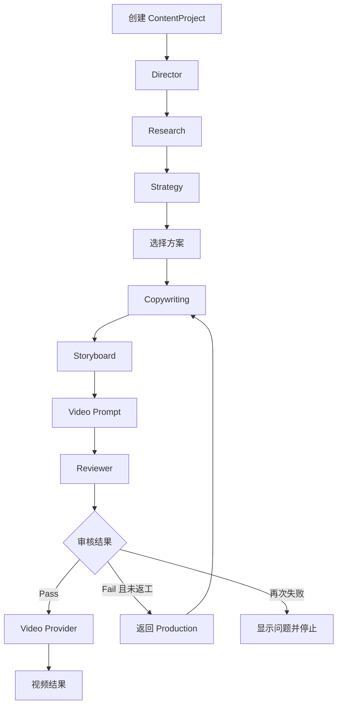
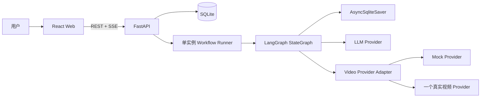

# 融资 Demo MVP 技术方案

> 状态：待确认  
> 日期：2026-07-16  
> 目标：用最小可运行系统证明“一句话需求驱动 AI 内容团队完成营销视频”的产品价值。

## 1. MVP 结论

融资 Demo 保留两个核心原则：

1. 使用 LangGraph 管理确定性的 Agent 工作流。
2. 使用 Project-first 架构，所有输入、Agent 结果和视频结果都归属于一个 `ContentProject`。

MVP 只完成一条纵向链路：

```text
一句需求 + @引用 / 案例蓝图
→ Director 理解需求
→ 市场研究
→ 三套内容方案
→ 内容制作（文案、分镜、视频提示词）
→ 质量审核
→ 真实视频 Provider
→ 视频结果
```

本阶段不建设企业级平台底座，不追求多工作流、多组织、多 Provider 和完整资产闭环。

## 2. MVP 范围

### 2.1 必须实现

- `ContentProject`
- Director Agent
- Research Agent
- Strategy Agent
- Production Agent
  - Copywriting Node
  - Storyboard Node
  - Video Prompt Node
- Reviewer Agent
- 首页一句话输入
- `@品牌`、`@商品`、`@参考视频`、`@案例模板`
- 可执行案例蓝图入口
- 四个前台 Agent 的执行状态
- 营销方案、文案、分镜和审核结果
- 开发阶段 Mock 视频 Provider
- Demo 阶段一个真实视频 Provider
- 可播放的视频结果

### 2.2 暂不实现

- 多组织、多租户和复杂 RBAC
- 完整登录、成员和企业权限系统
- 多阶段审批流和审批记录中心
- Redis、Celery、分布式 Worker 和高可用部署
- PostgreSQL Checkpointer 集群
- 完整素材资产库、收藏、积分和退款系统
- 多个真实视频 Provider 同时接入
- 单镜头候选、锁定、版本恢复和最终重合成
- 企业模板市场和复杂蓝图编辑器
- 自动分发、矩阵账号、投放和效果归因
- `script_to_video`、`reference_remix` 等多套完整工作流

这些能力保留扩展边界，但不进入融资 Demo 验收。

## 3. 产品呈现

### 3.1 前台只展示四个 Agent

| 前台角色 | 内部实现 | 用户看到的结果 |
| --- | --- | --- |
| 市场研究 | Research Agent | 受众洞察、内容趋势、建议和信息来源类型 |
| 内容策划 | Strategy Agent | 三套差异化方案、Hook、结构、CTA 和推荐理由 |
| 内容制作 | Production Agent：Copywriting、Storyboard、Video Prompt | 文案、镜头时间轴和视频生成提示词 |
| 质量审核 | Reviewer Agent | 通过/返工、问题列表和修改节点 |

Director Agent 在内部执行，不单独展示为第五张 Agent 卡片。它负责解析输入、绑定 `@` 引用并生成 Creative Brief；前台可在项目概览中显示“AI 总监已理解需求”，但不占用 Agent 队列位置。

### 3.2 页面范围

MVP 只做三个页面：

1. 首页
   - 一句话输入框
   - `@` 引用菜单
   - 案例蓝图卡片
   - 目标平台、时长、画幅三个必要参数
2. 项目执行页
   - 左侧四个 Agent 状态
   - 中间当前结果
   - 右侧已绑定的品牌、商品、参考视频和案例模板
3. 结果页
   - 营销方案
   - 文案
   - 分镜
   - 审核摘要
   - 视频播放器和生成状态

项目列表、品牌中心和资产中心不作为独立页面；Demo Seed 数据通过首页 `@` 菜单直接使用。

## 4. DAAI 风格的 `@` 引用

### 4.1 支持类型

```text
@品牌
@商品
@参考视频
@案例模板
```

输入框中的引用不是普通文本，而是结构化 Token：

```json
{
  "type": "brand",
  "id": "brand_whale_burger",
  "label": "鲸堡汉堡"
}
```

项目创建时分别提交：

- `request_text`：用户自然语言需求
- `references`：结构化引用列表

Director 只能读取引用实体中的已知事实，不能从显示文本反推价格、地址或活动。

### 4.2 MVP 数据来源

不建设完整品牌和资产系统。MVP 提供 Seed Catalog：

- 1 个品牌：鲸堡汉堡
- 1—2 个商品
- 1 个参考视频记录
- 3 个案例蓝图

品牌、商品和模板使用数据库 Seed 数据；参考视频保存一个合法演示文件或受控 URL。后续可将 Catalog 接口替换为真实品牌中心和资产库，前端引用协议保持不变。

## 5. 可执行案例蓝图

案例蓝图不是作品展示，而是创建项目的参数模板。

### 5.1 MVP 蓝图结构

```json
{
  "id": "local_food_store_video",
  "name": "本地餐饮到店获客",
  "description": "20 秒竖屏门店获客视频",
  "default_request": "为门店制作一条有食欲感的到店获客视频",
  "required_reference_types": ["brand", "product"],
  "platform": "douyin",
  "duration_seconds": 20,
  "aspect_ratio": "9:16",
  "strategy_hint": "前三秒产品特写，突出核心卖点，结尾明确到店 CTA",
  "storyboard_rules": [
    "产品在前三秒出现",
    "必须包含 CTA 镜头"
  ]
}
```

### 5.2 内置蓝图

1. 本地餐饮到店获客
2. 电商商品卖点视频
3. 真人口播种草视频

用户点击蓝图后：

- 自动填入默认需求和生成参数
- 提示补齐缺失的 `@品牌`、`@商品` 或 `@参考视频`
- 将蓝图规则传给 Director、Strategy、Storyboard 和 Reviewer
- 一键创建并启动 `ContentProject`

MVP 不支持用户创建和编辑蓝图；蓝图先作为版本化 JSON/YAML Seed 文件维护。

## 6. LangGraph 工作流

### 6.1 主图



### 6.2 MVP 简化规则

- 只注册一条完整工作流：`topic_to_video`。
- Director 不允许动态创建 Agent 或节点。
- Research 默认执行，不实现复杂路由。
- Strategy 固定输出三套方案。
- 默认自动采用推荐方案，用户可在 Production 开始前切换。
- 不建设通用审批引擎；“选择方案”只是项目字段和一次继续动作。
- Reviewer 最多触发一次自动返工；第二次失败后停止并展示问题。
- 视频提交前必须 Reviewer `pass`。
- 每个节点只写自己负责的 State 字段。

### 6.3 Workflow State

```python
class ContentWorkflowState(TypedDict, total=False):
    project_id: str
    request_text: str
    references: list[dict]
    blueprint: dict | None
    creative_brief: dict
    research: dict
    strategies: list[dict]
    selected_strategy_id: str
    copywriting: dict
    storyboard: dict
    video_prompt: dict
    review: dict
    video_task: dict
    completed_nodes: list[str]
    retry_count: int
    errors: list[dict]
```

### 6.4 结构化输出

所有 Agent 输出使用 Pydantic Schema：

- Director：行业、产品、平台、目标、受众、内容方向和 Brief
- Research：受众洞察、竞品模式、内容趋势、建议和来源类型
- Strategy：三套方案、Hook、结构、CTA、评分和推荐理由
- Copywriting：标题、前三秒 Hook、口播、字幕和 CTA
- Storyboard：镜头序号、时间、画面、动作、机位、字幕和口播
- Video Prompt：Provider 所需的总提示词、画幅、时长和参考素材
- Reviewer：`pass/fail`、问题、严重级别、返回节点和修改建议

模型输出解析失败时只允许一次结构修复；再次失败则节点失败，不能用空对象伪装成功。

## 7. MVP 技术架构



### 7.1 技术选型

| 层 | 选型 | MVP 理由 |
| --- | --- | --- |
| 前端 | React 19 + TypeScript + Vite | 单页 Demo、开发快、交互和状态展示足够 |
| 后端 | Python 3.12 + FastAPI + Pydantic v2 | 与 LangGraph 同语言，结构化接口清晰 |
| 编排 | LangGraph `StateGraph` | 显式节点、状态、返工和恢复 |
| 业务数据 | SQLite + SQLAlchemy 2 | 单实例 Demo 无需独立数据库服务 |
| 迁移 | Alembic | 保留可升级性，成本可控 |
| Checkpointer | `AsyncSqliteSaver` | 本地持久化和恢复，不部署 PostgreSQL Checkpointer |
| 实时状态 | SSE | 单向状态流足够，复杂度低于 WebSocket |
| 测试 | Pytest + Vitest + Playwright | 覆盖工作流、页面和演示主链路 |

### 7.2 执行方式

- API 创建项目后写入一条本地持久化 Job。
- FastAPI lifespan 启动单实例 `WorkflowRunner`，异步领取 Job。
- WorkflowRunner 执行 LangGraph，不阻塞 HTTP 请求。
- 每个节点完成后更新 Project、Artifact 和 Agent 状态。
- 服务重启时扫描 `running/pending` Job，并从 SQLite checkpoint 恢复。
- 单实例部署，不处理多机并发和分布式锁。

该方式不是最终生产队列，但足够支撑融资 Demo；未来可将 SQLite、Runner 和 Checkpointer分别替换为 PostgreSQL、正式 Worker 和 PostgreSQL Checkpointer，Agent 图不需要重写。

## 8. 最小数据模型

MVP 只保留七类数据：

| 数据 | 用途 |
| --- | --- |
| `content_projects` | 请求、当前状态、当前节点、引用和最终结果 |
| `content_artifacts` | Brief、Research、Strategy、Copywriting、Storyboard、Video Prompt、Review |
| `agent_runs` | 四个前台 Agent 的状态、开始时间、结束时间和错误 |
| `project_references` | `@品牌`、`@商品`、`@参考视频`、`@案例模板` |
| `project_events` | SSE 事件和执行时间线 |
| `video_tasks` | Provider、外部任务 ID、状态、错误和视频 URL |
| `workflow_jobs` | 本地 Runner 的待执行、运行、完成和失败任务 |

蓝图和 Demo Catalog 使用版本化 Seed 文件，不单独设计后台管理表。

不实现：

- `organization_id`
- 完整用户和权限表
- Approval 表
- Shot/ShotVersion 表
- 积分和账单表
- 资产收藏和文件夹表
- 复杂 Artifact 依赖与 `stale` 传播

## 9. API 范围

```text
GET    /api/catalog/references?q=&types=
GET    /api/blueprints
GET    /api/blueprints/{blueprint_id}

POST   /api/content-projects
GET    /api/content-projects/{project_id}
POST   /api/content-projects/{project_id}/start
POST   /api/content-projects/{project_id}/select-strategy
POST   /api/content-projects/{project_id}/retry
GET    /api/content-projects/{project_id}/events

GET    /api/content-projects/{project_id}/video-task
```

MVP 不做通用 Artifact 编辑 API。Strategy 选择、必要的文案/分镜微调可通过项目专用接口补充，避免提前设计完整内容管理平台。

## 10. 视频 Provider 方案

### 10.1 开发阶段

使用 `MockVideoProvider`：

```text
queued → processing → completed
```

Mock 只用于前后端联调和自动测试，界面必须显示“开发模拟结果”。

### 10.2 Demo 阶段

接入且只接入一个真实视频 Provider。适配器最小接口：

```python
class VideoProvider(Protocol):
    async def submit(self, request: VideoRequest) -> VideoTask: ...
    async def get_status(self, task_id: str) -> VideoTask: ...
```

真实 Provider 验收标准：

- 使用正式 API 和用户提供的合法凭证
- 能接收视频提示词、时长、画幅和可选参考素材
- 返回真实外部任务 ID
- 能轮询到成功或失败状态
- 成功后返回可播放的视频 URL 或下载后的本地文件
- 页面显示 Provider 名称和真实任务状态
- 失败时明确显示失败，不自动伪装为 Mock 成功

实施时优先选择已有账号和稳定 API 的 Provider；若用户已有 Seedance 或其他视频服务凭证，优先接入该服务。MVP 不同时适配多个供应商。

### 10.3 融资现场兜底

- 现场优先发起一次真实任务。
- Provider 生成通常耗时较长，因此同时准备一个“此前由同一真实 Provider 成功生成”的历史结果。
- 历史结果必须明确标注为“预生成真实结果”，不能冒充本次实时生成。
- 网络或 Provider 故障时展示真实任务错误和预生成结果，保证演示不中断且不伪造状态。

## 11. 前端交互

### 11.1 首页

- 顶部一句话价值说明
- 大输入框，输入 `@` 弹出四类引用
- 已选引用以 Chip 展示，可删除
- 三张可执行蓝图卡片
- “开始创作”主按钮

### 11.2 执行页

左侧固定展示：

```text
市场研究
内容策划
内容制作
质量审核
```

状态只有：

```text
等待中 / 执行中 / 已完成 / 需要处理 / 失败
```

内容制作展开显示：

```text
文案 → 分镜 → 视频提示词
```

中间区域按执行进度逐步出现内容，避免只显示日志或 JSON。右侧显示本项目的 `@` 引用和蓝图约束。

### 11.3 结果页

- 推荐方案和选择理由
- 标题、Hook、口播、字幕、CTA
- 分镜卡片和时间轴
- Reviewer 结论
- 真实视频任务状态
- 视频播放器

## 12. 推荐目录结构

```text
JHAi-to-C/
├── apps/
│   ├── api/
│   │   ├── app/
│   │   │   ├── api/
│   │   │   ├── agents/
│   │   │   ├── workflow/
│   │   │   ├── schemas/
│   │   │   ├── services/
│   │   │   ├── providers/
│   │   │   │   ├── llm/
│   │   │   │   └── video/
│   │   │   ├── prompts/
│   │   │   ├── seed/
│   │   │   └── main.py
│   │   ├── migrations/
│   │   ├── tests/
│   │   └── pyproject.toml
│   └── web/
│       ├── src/
│       │   ├── pages/
│       │   ├── features/project/
│       │   ├── features/composer/
│       │   ├── features/blueprints/
│       │   ├── components/
│       │   └── api/
│       ├── tests/
│       └── package.json
├── data/
│   ├── app.db
│   └── sample-assets/
├── docs/
├── .env.example
└── README.md
```

这是确认后的目标结构，当前不创建代码目录。

## 13. 开发阶段

### Phase 0：骨架与契约（0.5—1 工程日）

- 固定依赖版本和环境变量。
- 定义 Workflow State、Pydantic Schema 和 API 契约。
- 准备品牌、商品、参考视频和三个蓝图 Seed。
- 确认真实 LLM 和视频 Provider 凭证。

验收：依赖可安装，Provider 账号和 API 可调用。

### Phase 1：LangGraph 后端闭环（2—3 工程日）

- ContentProject、Artifact、AgentRun、Event、VideoTask、Job。
- Director、Research、Strategy、Production、Reviewer。
- Mock LLM/Research/Video Provider。
- 单实例 WorkflowRunner、SQLite checkpoint 和 SSE。
- 完整 Mock 流程测试。

验收：接口可从一句需求跑到 Mock 视频结果。

### Phase 2：融资 Demo 前端（2—3 工程日）

- 首页 `@` 输入和案例蓝图。
- 四 Agent 执行页。
- 方案、文案、分镜、审核和视频结果页。
- SSE 更新、错误状态和 Mock 标识。

验收：用户无需查看 JSON 即可理解 AI 团队的执行过程。

### Phase 3：真实 Provider（1—2 工程日，不含供应商审核时间）

- 接入一个真实 LLM Provider。
- 接入一个真实视频 Provider。
- Provider 任务轮询、超时和失败展示。
- 生成至少一个正式 Demo 视频并保留预生成结果。

验收：线上演示环境能生成并播放真实 Provider 视频。

### Phase 4：演示打磨（1—2 工程日）

- 固定演示脚本和 Seed 数据。
- 优化执行状态、等待反馈和结果呈现。
- 完成主链路 E2E、构建和现场故障演练。

预计总量：约 7—11 个工程日，不包含真实 Provider 开通、额度审批和不可控生成排队时间。

## 14. 测试与验收

### 14.1 自动测试

- Director 正确解析一句需求和四类 `@` 引用。
- 蓝图必填引用检查和默认参数填充。
- Research 不把模型推断伪装为实时来源。
- Strategy 返回三套有明显差异的方案。
- Copywriting、Storyboard、Video Prompt Schema 校验。
- 分镜总时长和时间线不重叠。
- Reviewer 可通过或返回 Production，且最多自动返工一次。
- 视频审核未通过时不得提交 Provider。
- Mock 主链路完整运行。
- SSE 正确显示四个 Agent 状态。

### 14.2 真实 Provider 测试

真实视频生成测试不放入常规 CI，避免费用和不稳定等待；在 Demo 发布前执行人工 Smoke Test：

1. 提交真实视频任务。
2. 保存外部任务 ID。
3. 轮询到终态。
4. 验证视频可播放。
5. 验证失败时不会显示 Mock 成功。

### 14.3 MVP 验收链路

```text
选择“本地餐饮到店获客”蓝图
→ 输入需求
→ @鲸堡汉堡
→ @双层牛肉芝士堡
→ 启动项目
→ 看到四个 Agent 依次执行
→ 看到三套营销方案
→ 看到文案、分镜和视频提示词
→ Reviewer 通过或完成一次返工
→ 提交真实视频任务
→ 播放视频结果
```

## 15. 风险与控制

| 风险 | MVP 控制方式 |
| --- | --- |
| 真实视频生成慢 | 提前生成真实备用结果，现场状态如实展示 |
| Provider API 不稳定 | 只接一个已验证 Provider，设置超时和错误提示 |
| 模型输出格式错误 | Pydantic 校验和一次结构修复 |
| 生成内容质量波动 | 固定 Seed、蓝图规则和演示输入，保留人工选择方案 |
| SQLite 单实例限制 | 明确只用于融资 Demo，后续迁移 PostgreSQL |
| 进程重启中断 | 本地 Job + AsyncSqliteSaver 启动恢复 |
| Research 缺少实时数据 | 明确区分 Seed 数据、用户事实和模型推断 |
| 范围再次膨胀 | 以主链路验收为唯一优先级，企业能力不进入本期 |

## 16. 确认项

进入编码前只需确认三个执行条件：

1. 同意 MVP 使用 SQLite + 单实例 WorkflowRunner，不部署 Redis/Celery/PostgreSQL 集群。
2. 提供或确认一个真实 LLM Provider 和一个真实视频 Provider 的账号、API 权限与额度。
3. 同意本期只交付 `topic_to_video` 主链路，权限、资产、镜头级版本和多租户后置。

确认后进入 Phase 0；在确认前不编写业务代码。

