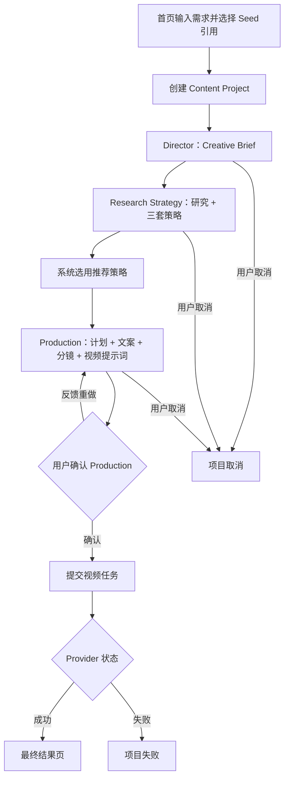

# AI 内容生产平台产品需求文档（PRD）

## 0. 文档信息

| 项目 | 内容 |
| --- | --- |
| 产品名称 | JHAi-to-C |
| 产品定位 | 企业可控型 AI 营销内容生产平台 |
| 文档版本 | v1.0 |
| 产品代码基线 | API v0.3.0 |
| 文档日期 | 2026-07-17 |
| 文档状态 | 当前产品基线，可用于后续排期与验收 |
| 当前交付形态 | 持续开发中的正式产品基线 |
| 正式前端 | `apps/web/` |
| 正式后端 | `apps/api/` |

本文档综合当前代码、根 README、项目约束、历史任务书、阶段报告和最新产品决策整理。发生冲突时，以当前主应用实际行为和最新产品决策为准。

### 0.1 状态定义

| 状态 | 定义 |
| --- | --- |
| 已完成 | 主应用已有可运行前后端闭环，并有测试或代码证据 |
| 部分完成 | 已有数据结构、API 或部分交互，但尚未形成完整用户闭环 |
| 未完成 | 主应用没有对应产品能力，或仅存在历史设计文档 |
| 待确认 | 产品规则仍需负责人做明确选择 |

---

## 1. 产品概述

### 1.1 产品定位

本产品不是一个单点 AI 视频生成器，也不是把多个 Agent 角色卡片拼在一起的聊天工具，而是一个以内容项目为中心的企业级 AI 营销内容生产平台。

核心原则是 **Project-first（项目优先）**：一次创作首先是一个 Content Project。品牌事实、商品、门店、人物、活动、参考素材、Agent 产物、审批、版本、镜头、生成任务、最终成片和企业模板都归属于该项目。

### 1.2 一句话价值

用户从一句营销需求开始，获得一套可查看、可修改、可审批、可局部重做，并能沉淀为企业资产的完整内容生产结果。

### 1.3 最终产品形态

最终产品应具备以下闭环：

```text
创建内容项目
→ 绑定品牌事实、商品/门店/人物/活动和参考素材
→ Director 生成 Creative Brief
→ Research Strategy 完成资料研究并生成三套策略
→ Production 生成制作计划、文案、分镜和视频提示词
→ 用户查看完整 Production 文档并确认或反馈重做
→ 提交视频生成任务
→ 查看生成状态和结果
→ 编辑、锁定或重做单个镜头
→ 重新合成最终成片
→ 保存为项目资产和企业蓝图
```

### 1.4 当前阶段结论

当前已经完成“从一句需求到完整营销方案，再到 Mock/Real 视频任务”的核心纵向 Demo；尚未完成企业级产品所需的品牌事实中心、项目管理、Artifact 在线编辑与失效传播、镜头级生产、组织权限、成本积分和完整资产闭环。

---

## 2. 产品目标与边界

### 2.1 产品目标

1. 让非专业用户用一句自然语言需求启动完整营销内容生产。
2. 用专业 Agent 分工形成结构化、可审计的内容产物，而不是只返回一段聊天文本。
3. 通过品牌事实锁定、人工确认、版本记录和局部重做提高企业内容的可控性。
4. 将一次性生成结果沉淀为可复用的品牌资产、内容蓝图和项目经验。
5. 同时支持可离线演示的 Mock Provider 和明确配置的真实 Provider。

### 2.2 当前 Demo 目标

1. 演示三位 Agent 的真实后端协作链路。
2. 演示结构化研究、三套策略、文案、分镜和视频提示词。
3. 演示 Production 最终审批、带反馈重做和任务取消。
4. 演示视频任务状态、最终结果页和真实 Provider 接入能力。
5. 演示 AI 视频、AI 图片、画布和资产的后端持久化与修订基础。

### 2.3 明确非目标

- 不训练或微调自有大模型。
- 不做无限自主循环的 Supervisor。
- 不实现抖音全平台数据抓取或承诺爆款预测。
- 不做完整数字人、模特换装或复杂投流系统。
- 不直接复制 DAAI 或“内容特工队”的导航、Logo、角色形象和源代码。
- 不在当前 Demo 中实现真正的多人实时协同编辑。
- 不把普通函数、搜索和视频生成服务包装成 Agent。

---

## 3. 目标用户与角色

| 用户角色 | 核心诉求 | 典型操作 |
| --- | --- | --- |
| 企业市场负责人 | 保证内容符合品牌和营销目标 | 维护品牌事实、发起项目、审批结果、查看成本 |
| 内容策划/运营 | 快速获得可执行的营销方案 | 选择蓝图、编辑策略和文案、调整平台与 CTA |
| 视频制作人员 | 获得可拍摄、可生成的分镜 | 编辑镜头、替换素材、锁定镜头、局部重做 |
| 团队审核人 | 控制事实、合规和发布质量 | 查看变更、审批版本、检查风险和生成结果 |
| 系统管理员 | 管理组织数据与供应商配置 | 用户权限、Provider、额度、资产和审计配置 |

当前 Demo 没有用户、组织和权限模型，所有操作默认以匿名或前端填写的协作人执行。

---

## 4. 已确认的产品决策

### 4.1 Agent 拓扑

当前默认只保留三位真实 LLM Agent：

| Agent | 职责 | 核心输出 |
| --- | --- | --- |
| Director | 理解需求并形成执行约束 | Creative Brief |
| Research Strategy | 联网/Mock 研究并制定策略 | Research + 3 套 Strategy |
| Production | 将策略转成完整制作包 | Production Plan + Copywriting + Storyboard + Video Prompt |

Reviewer 已从默认 Registry 和主工作流移除。当前由用户对完整 Production 结果做最终质量判断，确认后直接进入视频生成。

### 4.2 审批规则

- Director 和 Research Strategy 的中间结果默认自动继续。
- Research Strategy 默认自动选择推荐策略。
- Production 完整产物生成后必须暂停，等待用户确认。
- 用户可批准继续，也可填写反馈并重做 Production。
- 重做不能覆盖历史事件和旧版本产物。
- 后续可将“策略确认”扩展为可配置审批模式，但不是当前默认行为。

### 4.3 交互原则

- 首页保持安静、以创作为中心，AI Composer 是唯一主焦点。
- 提交需求后进入独立 Agent 工作区，不把执行过程追加在首页信息流下方。
- Agent 工作区使用单列对话式呈现，展示真实 Agent 产物和简洁协作摘要。
- 不展示虚假百分比，不暴露模型内部原始思维链。
- 完整结构化产物必须在审批按钮上方可读，摘要不能替代正式交付。
- 最终交付应支持一份可阅读、可下载的 Markdown 文档。

### 4.4 Provider 原则

- LLM、Research、Video Provider 独立配置。
- Mock 模式必须明确标识，不能伪装成真实生成。
- 真实 Provider 配置缺失时必须启动失败或明确报错，不得静默回退到 Mock。
- 视频和图片生成属于 Tool/Service，不属于 Agent。

---

## 5. 信息架构

### 5.1 最终信息架构

| 一级模块 | 主要能力 | 当前状态 |
| --- | --- | --- |
| 首页 | 统一输入、引用、场景蓝图、启动参数 | 部分完成 |
| Agent 工作区 | 执行对话、产物、审批、反馈、取消 | 已完成核心链路 |
| 内容项目 | 项目列表、筛选、归档、恢复、结果 | 部分完成，仅有项目详情与结果 |
| 品牌中心 | 品牌、商品、门店、人物、活动、事实锁定 | 未完成 |
| 案例蓝图 | 查看、填槽、一键创建、保存企业模板 | 部分完成，仅有 3 套前端 Seed |
| AI 视频 | 参数编辑、任务提交、预览、收藏 | 规划中，后续按独立产品模块实现 |
| AI 图片 | 图片生成、参考图、结果管理 | 规划中，后续按独立产品模块实现 |
| 画布 | 节点、连线、布局、可视化编辑 | 规划中，后续按独立产品模块实现 |
| 资产 | 上传、标签、版权、项目引用、复用 | 规划中，后续按独立产品模块实现 |
| 作品/发布 | 成片、发布包、历史版本 | 未完成 |
| 系统管理 | 用户、组织、权限、Provider、额度、审计 | 未完成 |

### 5.2 当前主应用路由

| 路由 | 页面 | 状态 |
| --- | --- | --- |
| `/` | 首页与统一创作输入 | 已完成 |
| `/projects/:id` | Agent 执行工作区 | 已完成 |
| `/projects/:id/result` | 最终结果页 | 已完成 |

---

## 6. 核心流程

### 6.1 当前已实现流程



### 6.2 最终产品补充流程

```text
结果生成
→ 用户编辑 Artifact 或单个 Shot
→ 系统产生新版本并标记受影响的下游结果 stale
→ 只重跑受影响节点或镜头
→ 用户选择候选并锁定满意镜头
→ 重新合成成片
→ 保存资产、企业蓝图和发布包
```

---

## 7. 功能需求与当前完成度

优先级定义：P0 为核心闭环，P1 为产品化必要能力，P2 为规模化与商业化能力。

### 7.1 首页与任务发起

| ID | 优先级 | 需求 | 验收标准 | 当前状态与差距 |
| --- | --- | --- | --- | --- |
| FR-HOME-001 | P0 | 统一自然语言输入 | 可输入 1–5000 字需求并创建、启动项目 | 已完成 |
| FR-HOME-002 | P0 | 引用上下文 | 支持绑定品牌、商品、门店、人物、活动、参考素材和蓝图 | 部分完成；当前仅支持品牌、商品、参考视频、蓝图四类 Seed 引用 |
| FR-HOME-003 | P0 | 上传图片和视频 | 文件上传后进入资产库，并可作为项目引用 | 未完成 |
| FR-HOME-004 | P0 | 场景蓝图 | 至少提供本地餐饮、电商商品、真人口播、参考重构四类 | 部分完成；已有前三类固定 Seed，参考重构未形成独立场景 |
| FR-HOME-005 | P1 | 启动参数 | 可设置平台、时长、画幅、研究开关、输出类型和审批模式 | 部分完成；后端支持平台、时长、画幅，主界面未开放完整设置 |
| FR-HOME-006 | P1 | 空 Agent 工作区 | 用户无需先提交需求即可进入工作区并创建新任务 | 已完成 |

### 7.2 Content Project

| ID | 优先级 | 需求 | 验收标准 | 当前状态与差距 |
| --- | --- | --- | --- | --- |
| FR-PROJ-001 | P0 | 创建与持久化项目 | 项目、引用、状态和时间写入数据库，刷新不丢失 | 已完成 |
| FR-PROJ-002 | P0 | 启动工作流 | HTTP 请求异步入队，重复启动只能成功一次 | 已完成；使用 CAS 防止重复启动 |
| FR-PROJ-003 | P0 | 项目详情 | 返回当前状态、最新产物、视频任务、错误和 Provider | 已完成 |
| FR-PROJ-004 | P0 | 项目取消 | 终止本地执行和后续任务，保留已产生事件 | 已完成 |
| FR-PROJ-005 | P1 | 项目列表与搜索 | 查看历史项目，按状态、时间、品牌筛选 | 未完成 |
| FR-PROJ-006 | P1 | 项目恢复 | 应用或 Worker 重启后自动重新领取未完成任务 | 未完成；Job 与 Checkpoint 已持久化，但 Runner 启动时不自动扫描恢复 |
| FR-PROJ-007 | P1 | 幂等键 | 创建、启动、重跑和生成接口支持 Idempotency-Key | 部分完成；启动有 CAS，并发决策有保护，但没有完整幂等键协议 |
| FR-PROJ-008 | P1 | 项目归档/复制 | 可归档、复制项目并保留来源关系 | 未完成 |

### 7.3 Agent 与工作流

| ID | 优先级 | 需求 | 验收标准 | 当前状态与差距 |
| --- | --- | --- | --- | --- |
| FR-AGENT-001 | P0 | Director | 生成通过契约校验的 Creative Brief | 已完成 |
| FR-AGENT-002 | P0 | Research Strategy | 调研并一次生成三套差异化策略，保留来源 | 已完成 |
| FR-AGENT-003 | P0 | Production | 一次生成计划、文案、分镜和视频提示词完整包 | 已完成 |
| FR-AGENT-004 | P0 | 结构化输出校验 | 所有 Agent 输出必须通过 Pydantic/JSON Schema 校验 | 已完成 |
| FR-AGENT-005 | P0 | 三次 LLM 调用基线 | 正常完整流程为三次 LLM 调用，重做另计 | 已完成 |
| FR-AGENT-006 | P0 | 最终人工确认 | Production 完成后后端真实暂停，支持批准或带反馈重做 | 已完成 |
| FR-AGENT-007 | P0 | 执行审计事件 | 持久化节点开始、完成、失败、摘要和完整输出 | 已完成 |
| FR-AGENT-008 | P0 | 安全进度摘要 | Thought 仅为面向用户的摘要，不暴露原始思维链 | 已完成设计与事件约束 |
| FR-AGENT-009 | P1 | 可配置审批模式 | 支持全自动、策略后、生成前、每阶段审批 | 部分完成；图层具备部分门禁能力，主产品只启用 Production 最终审批 |
| FR-AGENT-010 | P1 | 节点级独立重跑 | 用户可指定 Brief、Research、Production 等节点重跑 | 部分完成；当前主要支持 Production 审批点重做 |

### 7.4 Artifact、审批与结果

| ID | 优先级 | 需求 | 验收标准 | 当前状态与差距 |
| --- | --- | --- | --- | --- |
| FR-ART-001 | P0 | 结构化产物 | 保存 Brief、Research、Strategy、Copywriting、Storyboard、Video Prompt | 已完成 |
| FR-ART-002 | P0 | 完整交付展示 | 审批前能阅读完整 Production 内容，不能只有摘要 | 已完成 |
| FR-ART-003 | P0 | 最终结果页 | 展示已选策略、文案、分镜时间轴、Provider 和视频结果 | 已完成 |
| FR-ART-004 | P0 | Markdown 交付 | Production 审批内容和最终项目可预览、下载为单一 Markdown | 已完成 |
| FR-ART-005 | P1 | 在线编辑 | 可编辑 Strategy、Copywriting、Storyboard 并保存新版本 | 未完成 |
| FR-ART-006 | P1 | Artifact 版本历史 | 每次 Agent 或用户修改记录来源、创建人、版本和时间 | 部分完成；Agent Artifact 有递增版本，但缺少来源、创建人和产品化历史查看 |
| FR-ART-007 | P1 | 下游失效 | 上游修改后，受影响的下游 Artifact 自动标记 stale | 未完成 |
| FR-ART-008 | P1 | 审批记录 | 保留审批人、版本、动作、意见和时间 | 部分完成；事件记录动作与反馈，但无独立 Approval 实体和用户身份 |
| FR-ART-009 | P1 | 历史尝试保留 | 重做后仍可查看旧版本和旧反馈 | 部分完成；数据库和事件保留，主界面缺少完整版本切换 |

### 7.5 品牌事实与企业知识

| ID | 优先级 | 需求 | 验收标准 | 当前状态与差距 |
| --- | --- | --- | --- | --- |
| FR-FACT-001 | P0 | 品牌实体 | 维护品牌、商品、门店、人物、活动、报价、视觉和声音身份 | 未完成；当前只有项目引用快照 |
| FR-FACT-002 | P0 | 事实锁定 | 价格、地址、活动期等必须绑定事实 ID，下游不得自由改写 | 未完成 |
| FR-FACT-003 | P0 | 禁用词和过期校验 | 禁用表达不可输出，过期活动不可引用 | 未完成 |
| FR-FACT-004 | P1 | 事实变更传播 | 事实修改后关联产物自动 stale | 未完成 |
| FR-FACT-005 | P1 | 企业知识库 | Research 可检索组织内部资料并标注来源 | 未完成 |

### 7.6 案例蓝图

| ID | 优先级 | 需求 | 验收标准 | 当前状态与差距 |
| --- | --- | --- | --- | --- |
| FR-BP-001 | P0 | 三个可执行 Seed 蓝图 | 点击后填入需求、引用和默认参数并直接创建项目 | 已完成 |
| FR-BP-002 | P1 | 蓝图详情与变量槽 | 展示必填/选填实体、规则、结构和推荐参数 | 部分完成；Seed 内有固定结构，但无详情和补槽流程 |
| FR-BP-003 | P1 | 保存为企业蓝图 | 项目完成后可保存为组织私有模板 | 未完成 |
| FR-BP-004 | P1 | 蓝图版本和权限 | 蓝图可修订、归档，并受组织权限控制 | 未完成 |

### 7.7 镜头级生产

| ID | 优先级 | 需求 | 验收标准 | 当前状态与差距 |
| --- | --- | --- | --- | --- |
| FR-SHOT-001 | P0 | 结构化分镜时间轴 | 每个镜头有序号、时长、画面、动作、机位、字幕和提示词 | 已完成展示与结构化输出 |
| FR-SHOT-002 | P0 | 编辑单镜头 | 修改时长、画面、台词、提示词和参考素材 | 未完成 |
| FR-SHOT-003 | P0 | 单镜头生成/重做 | 使用幂等键只生成目标镜头，不重跑全部内容 | 未完成 |
| FR-SHOT-004 | P0 | 锁定镜头 | 已锁定镜头不被无关重跑覆盖 | 未完成 |
| FR-SHOT-005 | P1 | 候选与选择 | 一个镜头可有多个候选，支持选择、拒绝和恢复版本 | 未完成 |
| FR-SHOT-006 | P1 | 重新合成 | 镜头更新后可重新合成最终视频 | 未完成 |

### 7.8 AI 视频、AI 图片、画布与资产

| ID | 优先级 | 需求 | 验收标准 | 当前状态与差距 |
| --- | --- | --- | --- | --- |
| FR-STUDIO-001 | P0 | 模块边界设计 | 明确四个模块的用户任务、数据模型、权限与跨模块关系 | 未完成；不得用通用 JSON/API 编辑器代替真实功能 |
| FR-STUDIO-002 | P0 | AI 视频真实功能 | 可配置提示词、参考素材和参数并提交视频任务 | 未完成；现有 Content Project 视频链路可作为后续能力基础 |
| FR-STUDIO-003 | P1 | AI 图片真实功能 | 可上传参考图、提交图片任务并保存结果 | 未完成 |
| FR-STUDIO-004 | P1 | 可视化画布 | 可视化编辑节点、连线和布局，并连接生成工具 | 未完成 |
| FR-STUDIO-005 | P0 | 资产上传与复用 | 文件上传、元数据、版权、标签、项目引用和结果入库 | 未完成 |
| FR-STUDIO-006 | P1 | 项目归属 | 模块内容和生成结果必须归属或关联 Content Project | 未完成 |

### 7.9 实时状态、稳定性与 Provider

| ID | 优先级 | 需求 | 验收标准 | 当前状态与差距 |
| --- | --- | --- | --- | --- |
| FR-SYS-001 | P0 | SSE 实时事件 | 浏览器可订阅持久化事件，断线后从事件 ID 续读 | 已完成 |
| FR-SYS-002 | P0 | 轮询兜底 | SSE 不可用时仍能获得项目和视频状态 | 已完成 |
| FR-SYS-003 | P0 | Mock Provider | 离线完整演示并明确标记 Mock | 已完成 |
| FR-SYS-004 | P0 | Real LLM | OpenAI 兼容结构化输出、超时、重试、错误标准化 | 已完成实现和测试；历史报告记录过真实 Smoke |
| FR-SYS-005 | P0 | Real Research | 博查搜索、去重、超时、重试和来源映射 | 已完成实现和测试 |
| FR-SYS-006 | P0 | Real Video | Seedance/兼容网关提交、轮询和结果映射 | 已完成适配器和契约测试；尚未使用当前合法视频凭证完成付费实网验收 |
| FR-SYS-007 | P1 | Worker 恢复 | 应用重启后恢复 pending/running 工作 | 未完成 |
| FR-SYS-008 | P1 | 分布式执行 | 多 Worker 安全领取、心跳、超时和失败重试 | 未完成；当前为单进程 Runner |
| FR-SYS-009 | P1 | 外部任务取消 | 本地取消同时调用真实 Provider 的取消接口 | 部分完成；本地状态和后续队列会取消，未确认所有真实 Provider 均远程撤销 |

### 7.10 企业化、成本与分发

| ID | 优先级 | 需求 | 验收标准 | 当前状态与差距 |
| --- | --- | --- | --- | --- |
| FR-ENT-001 | P1 | 用户与组织 | 登录、组织、成员和角色权限 | 未完成 |
| FR-ENT-002 | P1 | 数据隔离 | 项目、品牌、资产和蓝图按组织隔离 | 未完成 |
| FR-ENT-003 | P1 | 审计日志 | 记录关键操作人、对象、时间和变更 | 部分完成；工作流事件完善，但缺少真实用户身份和管理界面 |
| FR-ENT-004 | P2 | 成本与积分 | 预估、扣除、失败退款、用量明细 | 未完成 |
| FR-ENT-005 | P2 | 发布包 | 生成标题、正文、标签、封面和发布时间建议 | 未完成 |
| FR-ENT-006 | P2 | 批量生产 | 一个蓝图批量套用多个商品、门店或人群 | 未完成 |
| FR-ENT-007 | P2 | 数据反馈 | 记录策略选择、镜头重做、候选选择等反馈事件 | 部分完成；已有部分工作流事件，未形成学习数据模型和分析能力 |

---

## 8. 数据与领域模型

### 8.1 当前已落库模型

| 模型 | 用途 | 状态 |
| --- | --- | --- |
| ContentProject | 项目基本信息、状态、选中策略和最终结果 | 已完成 |
| ProjectReference | 品牌、商品、参考视频、蓝图快照 | 已完成 |
| Artifact | 结构化产物及递增版本 | 已完成 |
| AgentRun | Agent 输入、输出、状态、尝试次数和错误 | 已完成 |
| ProjectEvent | 持久化事件与 SSE 数据源 | 已完成 |
| WorkflowJob | 异步运行、恢复决策和任务状态 | 已完成 |
| VideoTask | Provider 任务、进度、结果和错误 | 已完成 |
| StudioResource | 早期通用资源实验模型 | 内部保留，未注册为产品 API；后续按模块设计评估去留 |
| StudioResourceRevision | 早期通用修订实验模型 | 内部保留，未注册为产品 API |

### 8.2 最终产品仍需新增或扩展

- Organization、User、Membership、Role。
- BrandEntity 及品牌/商品/门店/人物/活动等事实实体。
- Approval 独立记录。
- Artifact 的 `source`、`created_by`、`stale` 和依赖关系。
- ContentShot、ShotVersion、ShotCandidate、ShotGenerationTask。
- ContentBlueprint 及其版本、组织归属和变量槽。
- Asset 文件对象、项目关系、版权、标签和生成来源。
- UsageLedger、CreditTransaction、ProviderCost。
- ContentFeedbackEvent 和发布包。

---

## 9. 非功能需求

| ID | 需求 | 验收标准 | 当前状态 |
| --- | --- | --- | --- |
| NFR-001 | 数据持久化 | 刷新页面后项目、产物、任务和事件不丢失 | 已完成，SQLite |
| NFR-002 | 契约可靠性 | Agent 输出拒绝未知字段和非法结构 | 已完成 |
| NFR-003 | 并发安全 | 重复启动和重复审批不会产生重复有效任务 | 已完成核心 CAS 保护 |
| NFR-004 | 可观察性 | 节点、Agent、Provider 和失败均有持久化记录 | 已完成核心能力 |
| NFR-005 | 安全 | 密钥不进入源码和响应，错误不泄漏密钥 | 已完成基础保护；鉴权和权限未完成 |
| NFR-006 | 可恢复性 | 应用重启后自动恢复未完成任务 | 未完成 |
| NFR-007 | 可扩展性 | 支持多 Worker、外部队列和生产数据库 | 未完成 |
| NFR-008 | 性能 | 明确并验证页面、API、Agent 和视频任务性能指标 | 未定义、未压测 |
| NFR-009 | 可访问性 | 核心表单、状态、审批和导航可通过键盘与读屏使用 | 部分完成，尚无完整审计 |
| NFR-010 | 响应式 | 桌面和移动端可完成核心项目流程 | 部分完成，已有响应式样式但未做完整设备矩阵验收 |

---

## 10. 当前完成情况摘要

### 10.1 已完成

- 一句话创建并启动 Content Project。
- 三个真实 Agent 的 LangGraph 主工作流。
- Research Provider 调研与三套策略生成。
- Production 一次生成计划、文案、分镜和视频提示词。
- Production 后端真实暂停、批准、反馈重做。
- 项目取消和本地任务终止。
- 项目、AgentRun、Artifact、事件、Job、VideoTask 持久化。
- SSE 实时事件和轮询兜底。
- Mock LLM、Research、Video 离线演示。
- Real LLM、博查 Research、Seedance/兼容视频适配器。
- 三套可执行 Seed 场景。
- 首页、Agent 工作区和最终结果页。
- 后端、前端和 Provider 的自动化测试基础。

### 10.2 部分完成

- 首页引用体系：仅有四类固定 Seed，无上传和完整企业实体。
- 参数与审批模式：后端有部分能力，前端未完整开放。
- Artifact 版本：有递增版本，无用户编辑、stale 和完整历史 UI。
- 真实视频：适配和测试完成，缺合法生产凭证下的付费实网验收。
- 审计：工作流事件完整，但没有用户、组织和权限身份。

### 10.3 未完成

- 项目列表、筛选、归档、复制和自动恢复。
- 品牌中心与企业事实锁定。
- 图片/视频上传和真正的资产库。
- Artifact 在线编辑、版本对比和下游 stale。
- 单镜头编辑、重做、锁定、候选和重新合成。
- 保存项目为企业蓝图。
- AI 视频、AI 图片、画布和资产四个独立产品模块。
- 用户、组织、多租户和权限。
- 分布式 Worker、生产数据库和任务恢复。
- 成本、积分、扣费与退款。
- 发布包、批量生产和反馈分析。

---

## 11. 建议后续里程碑

### Milestone A：稳定正式前端基线（P0）

1. 为 `apps/web` 补齐组件测试和端到端测试。
2. 修正所有旧的“四位 Agent/下一位 Agent/Reviewer”文案与兼容组件。
3. 增加项目历史列表，让已完成项目可被再次打开。
4. 使用真实视频凭证完成一次受控实网验收，并保留成本和错误记录。

验收结果：只有一套正式前端、一个明确工作流口径，并能重复打开历史项目。

### Milestone B：可控内容生产 MVP（P0/P1）

1. 建立 BrandEntity、事实锁定和品牌中心。
2. 增加文件上传与项目资产引用。
3. 支持 Artifact 在线编辑、版本历史和 stale 传播。
4. 建立 Shot、ShotVersion 和单镜头重做/锁定 API 与 UI。
5. 支持项目保存为组织蓝图。

验收结果：产品真正具备“企业可控”和“局部重做”两个核心差异点。

### Milestone C：企业化与规模化（P1/P2）

1. 用户、组织、RBAC 和数据隔离。
2. 可恢复 Worker、生产数据库、外部队列和任务幂等。
3. Studio 图片/视频生成、可视化画布和完整资产归档。
4. 成本、积分、退款和 Provider 用量账本。
5. 发布包、批量生产、反馈事件和运营分析。

验收结果：从融资 Demo 升级为可供真实团队持续使用的 SaaS 产品。

---

## 12. 验收口径

### 12.1 当前 Demo 可验收项

1. 用户可创建项目并绑定 Seed 引用。
2. Director、Research Strategy、Production 按顺序执行。
3. Research Strategy 生成三套策略，Production 读取推荐策略。
4. 文案与分镜为结构化输出，分镜有时间轴。
5. Production 完整产物在用户确认前可见。
6. 用户可批准、反馈重做或取消项目。
7. 批准后视频任务进入 queued、processing、completed/failed 状态。
8. Mock 与 Real Provider 状态明确，不静默降级。
9. 刷新后项目、产物、事件和结果仍可读取。
10. 最终结果页展示营销策略、文案、分镜和视频结果。

### 12.2 最终产品验收前必须补齐

1. 品牌关键事实不可被 Agent 自由改写。
2. 用户可编辑 Artifact，修改后下游正确 stale。
3. 单镜头可独立生成、重做、锁定和恢复版本。
4. 项目可保存为组织私有蓝图。
5. 文件资产可上传、引用并追溯版权和生成来源。
6. 应用和 Worker 重启后未完成任务可安全恢复。
7. 所有关键接口具备可验证的幂等性。
8. 用户、组织、权限和数据隔离通过安全验收。
9. 真实 Provider 的成本、失败补偿和任务取消形成闭环。
10. 完成前端可访问性、响应式、性能和浏览器矩阵验收。

---

## 13. 风险与待确认事项

### 13.1 主要风险

| 风险 | 影响 | 建议 |
| --- | --- | --- |
| 正式前端自动化测试不足 | 视觉和交互回归难以及时发现 | 补齐组件测试与关键链路 E2E |
| 历史文档仍描述 Reviewer 和多阶段审批 | 后续开发可能恢复已废弃流程 | 本 PRD 作为当前产品基线，并给历史文档加 Deprecated 标记 |
| 四个未来模块的范围和跨模块关系尚未定义 | 重复建设或出现错误抽象 | 先完成领域流程与数据模型设计，再分别实现真实功能 |
| 单进程 Runner 无重启恢复 | 真实任务可能成为孤儿 | 产品化前引入恢复扫描、租约/心跳或外部队列 |
| 品牌事实尚未结构化 | 价格、地址、活动可能被模型改写 | 在真实客户使用前优先完成事实中心和校验 |
| 真实视频尚未付费实网验收 | Demo 现场存在供应商风险 | 使用合法凭证做限额 Smoke，并准备明确的 Mock 兜底 |

### 13.2 待产品负责人确认

1. JHAi-to-C 的正式品牌视觉，以及是否继续保留 DAAI 参考风格。
2. Strategy 是始终自动采用推荐方案，还是向高级用户开放“策略确认”模式。
3. 首个商业版本只聚焦营销视频，还是同时交付图片套图和可视化画布。
4. 首批目标行业是本地餐饮、电商商品、真人口播，还是需要增加其他垂直场景。
5. 视频生成是整片优先还是镜头生成优先；这会直接影响 Provider、成本和 Shot 架构。
6. 企业蓝图和品牌事实由谁维护、谁审批、谁有权发布。
7. 计费方式采用积分、按任务、按 Provider 成本加成，还是企业套餐。

---

## 14. 当前验证记录

验证日期：2026-07-17。

| 验证项 | 结果 |
| --- | --- |
| 后端测试 | 103 项通过 |
| 后端 Ruff | 通过 |
| 正式前端测试 | 当前尚未建立自动化测试基线 |
| 正式前端生产构建 | Vite 生产构建通过 |
| 已知环境提示 | 正式发布应使用 Node.js 22.x 复验 |

本文档只将当前实际运行、代码和自动化测试可证明的能力标为“已完成”；历史计划或兼容代码不等同于主产品已交付。
